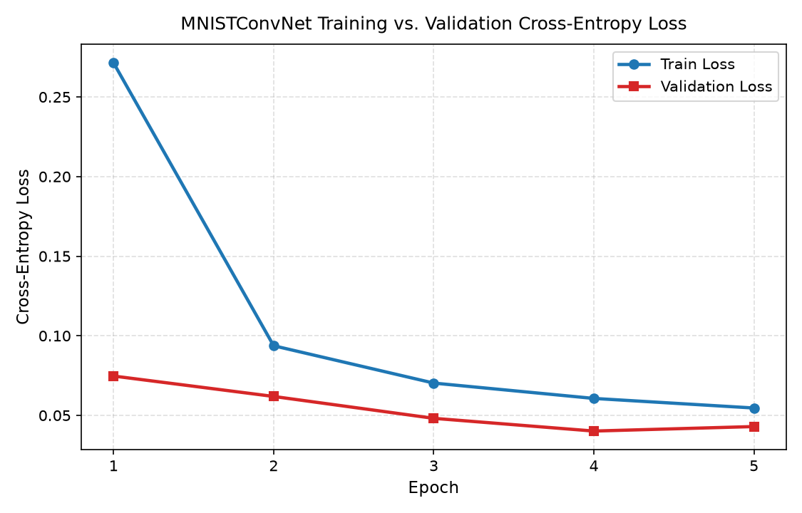
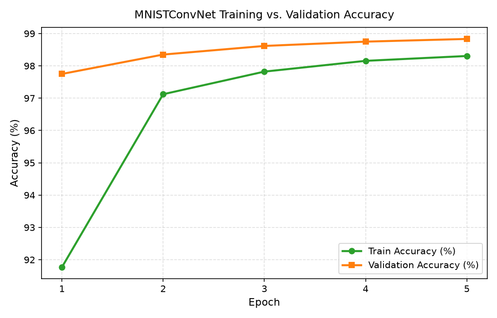
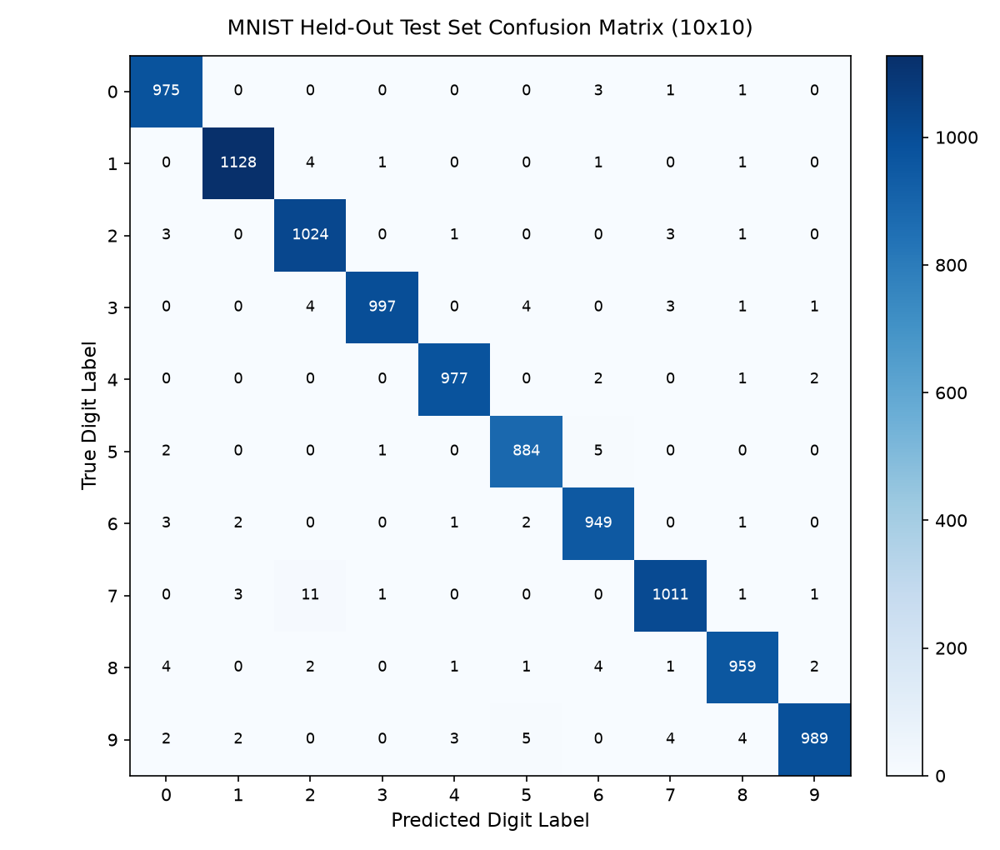

# MNIST Lab — Reproducible PyTorch Classification Pipeline & HF Space Demo

[](https://github.com/chrisjcc/mnist-lab/actions/workflows/ci.yml)
[](https://www.python.org/)
[](https://github.com/astral-sh/ruff)
[](https://mypy-lang.org/)

A reproducible, configuration-driven **MNIST handwritten digit classification pipeline** built with **PyTorch**, **Hydra**, **DVC**, **Weights & Biases (W&B)**, **Hugging Face Hub**, and an interactive **Streamlit Docker Space**.

---

## ✨ Key Architecture Highlights

- **Single Source of Truth (SSoT) Configuration**: Composable **Hydra** YAML schemas (`configs/`) synchronized with **DVC** parameters (`params.yaml`) and validated at runtime via strict Python dataclasses (`src/mnist_pipeline/config.py`).
- **Deterministic Data & Pipeline Versioning (`dvc.yaml`)**: Five-stage DAG (`preprocess -> train -> evaluate -> benchmark -> report`) with stratified train/validation splitting (`54,000 / 6,000 / 10,000`) and SHA-256 tensor checksums.
- **Experiment Tracking (`Weights & Biases`)**: Pluggable `ExperimentTracker` supporting `online`, `offline`, and `disabled` modes with automated metric, figure, and checkpoint artifact logging.
- **Hugging Face Hub Integration**: Automated `safetensors` serialization (`MNISTConvNet.save_pretrained` / `from_pretrained`), Jinja2-rendered Model & Dataset Cards (`docs/model_card.md`, `docs/dataset_card.md`), and CLI upload/inference scripts.
- **Interactive Hugging Face Docker Space (`app/`, `Dockerfile`)**: Streamlit web application supporting freehand digit drawing (`streamlit-drawable-canvas`), image uploads with automatic polarity inversion, and live 10-class probability bar charts.

---

## 📊 Minimum Viable Experiment (MVE) Baseline Results

Full experimental protocol, training curves, confusion matrix, and per-class evaluation tables are documented in [**`docs/experiments/mve_baseline_study.md`**](docs/experiments/mve_baseline_study.md).

| Metric / Benchmark | MVE Acceptance Target | Measured Baseline (`seed=42`) | Status |
| :--- | :---: | :---: | :---: |
| **Held-Out Test Accuracy ($N=10,000$)** | $\ge 98.50\%$ | **`98.93%` (`0.9893`)** | ✅ **PASS** |
| **Held-Out Test Macro F1-Score** | $\ge 0.9850$ | **`0.9892`** | ✅ **PASS** |
| **Minimum Per-Class F1 (`0`–`9`)** | $\ge 0.9800$ | **`0.9859` (Digit 7)** | ✅ **PASS** |
| **Best Validation Accuracy ($N=6,000$)** | $\ge 98.50\%$ | **`98.83%` (Epoch 5)** | ✅ **PASS** |
| **Single-Sample Latency (`batch_size=1`, P95)** | $< 25.0\text{ ms}$ | **`0.385 ms` (`3,341.6 samples/s`)** | ✅ **PASS** |
| **Batched Throughput (`batch_size=128`)** | $\ge 1,000\text{ samples/s}$ | **`10,465.1 samples/s`** | ✅ **PASS** |
| **Model Footprint (`MNISTConvNet`)** | $< 1\text{M params} / < 10\text{ MB}$ | **`421,834 params` (`1.61 MB` SafeTensors)** | ✅ **PASS** |

| Training vs. Validation Loss | Training vs. Validation Accuracy | Held-Out Test Confusion Matrix |
| :---: | :---: | :---: |
|  |  |  |

---

## 🚀 Quickstart

```bash
# 1. Create virtual environment and install dependencies
python3 -m venv .venv
source .venv/bin/activate
make setup

# 2. Run zero-budget synthetic smoke check (< 1s)
make smoke-eval

# 3. Run the end-to-end pipeline (Download -> Train -> Evaluate -> Benchmark -> Report)
make data
make train
make evaluate
make benchmark
make report
make evaluate-mve

# 4. Run inference on a test sample or custom image
make hf-infer ARGS="hf.sample_index=0"

# 5. Launch the interactive Streamlit demo locally
make app
```

---

## 🛠️ Makefile Command Reference

| Command | Description |
| :--- | :--- |
| `make setup` | Install all runtime and development dependencies into the active Python environment |
| `make data` | Download MNIST and persist stratified `train.pt`, `val.pt`, `test.pt`, and `split_metadata.json` |
| `make train` | Train `MNISTConvNet` using Hydra config (`ARGS="..."` for CLI overrides) |
| `make evaluate` | Evaluate `checkpoint_best.pt` on the 10,000 held-out test set |
| `make benchmark` | Benchmark latency (`p50`, `p95`, `p99`) and throughput across batch sizes `[1, 32, 128]` |
| `make report` | Generate training curves, confusion matrix, sample predictions, and Hub cards |
| `make evaluate-mve` | Verify all 5 Minimum Viable Experiment (MVE) acceptance criteria gates |
| `make smoke-eval` | Execute sub-second synthetic tensor contract and gradient flow verification |
| `make dvc-repro` | Reproduce the full 5-stage DVC pipeline (`dvc.yaml`) |
| `make hf-upload` | Stage and upload model weights, metrics, plots, and cards to Hugging Face Hub |
| `make hf-infer` | Load model from Hugging Face Hub (or local fallback) and run CLI digit inference |
| `make app` | Launch the interactive Streamlit digit classifier on `http://localhost:8501` |
| `make docker-build` | Build the Hugging Face Docker Space image locally |
| `make docker-run` | Run the Hugging Face Docker Space container on port `8501` |
| `make lint` | Run `ruff check`, `ruff format --check`, and `mypy src/` (strict mode) |
| `make test` | Run the full `pytest` unit and integration test suite |

---

## 📚 Documentation Index

- [**Step-by-Step User Guide (`docs/user_guide.md`)**](docs/user_guide.md): Comprehensive 9-part guide covering setup, data preprocessing, Hydra training, W&B tracking, evaluation/benchmarking, reporting, HF Hub upload/inference, and Docker Space deployment.
- [**MVE Baseline Study (`docs/experiments/mve_baseline_study.md`)**](docs/experiments/mve_baseline_study.md): Reproducible baseline instructions, acceptance gate adjudication, training curves, and test evaluation/benchmark tables.
- [**Model Card (`docs/model_card.md`)**](docs/model_card.md): Architecture details, training hyperparameters, per-class evaluation metrics, and latency benchmarks.
- [**Dataset Card (`docs/dataset_card.md`)**](docs/dataset_card.md): Dataset provenance, normalization formula, and stratified class distribution across splits.
- [**Implementation Plan (`docs/mnist_pytorch_pipeline_implementation_plan.md`)**](docs/mnist_pytorch_pipeline_implementation_plan.md): Complete architectural specification and design blueprint.
