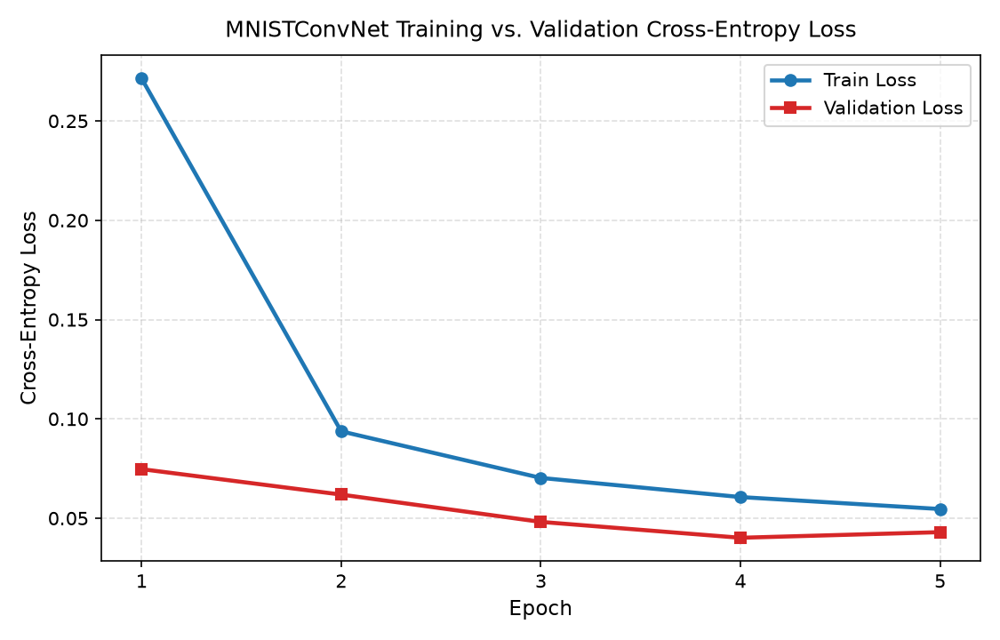
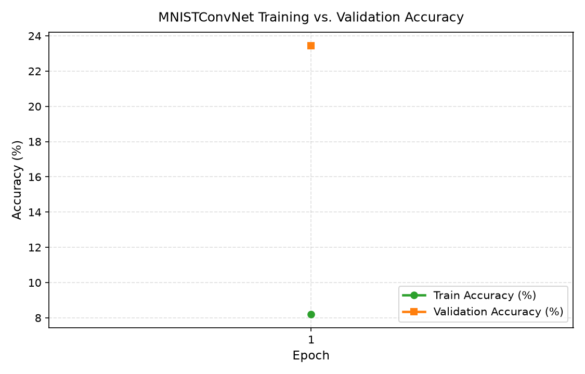
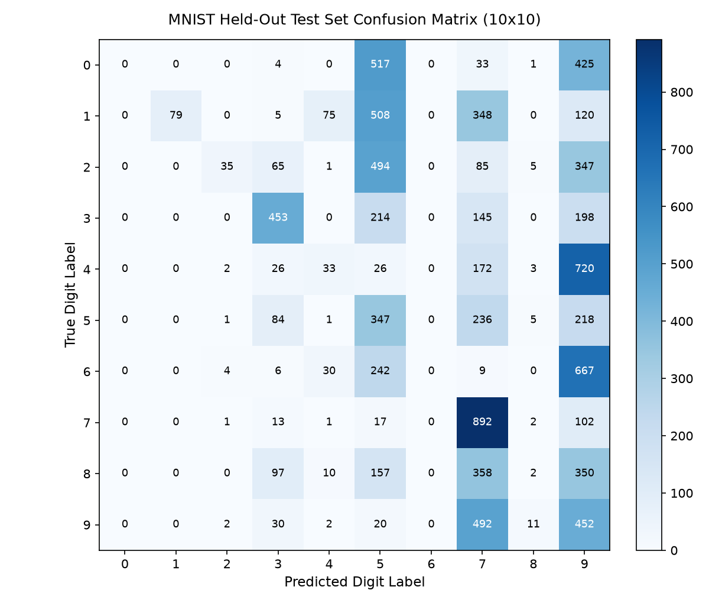
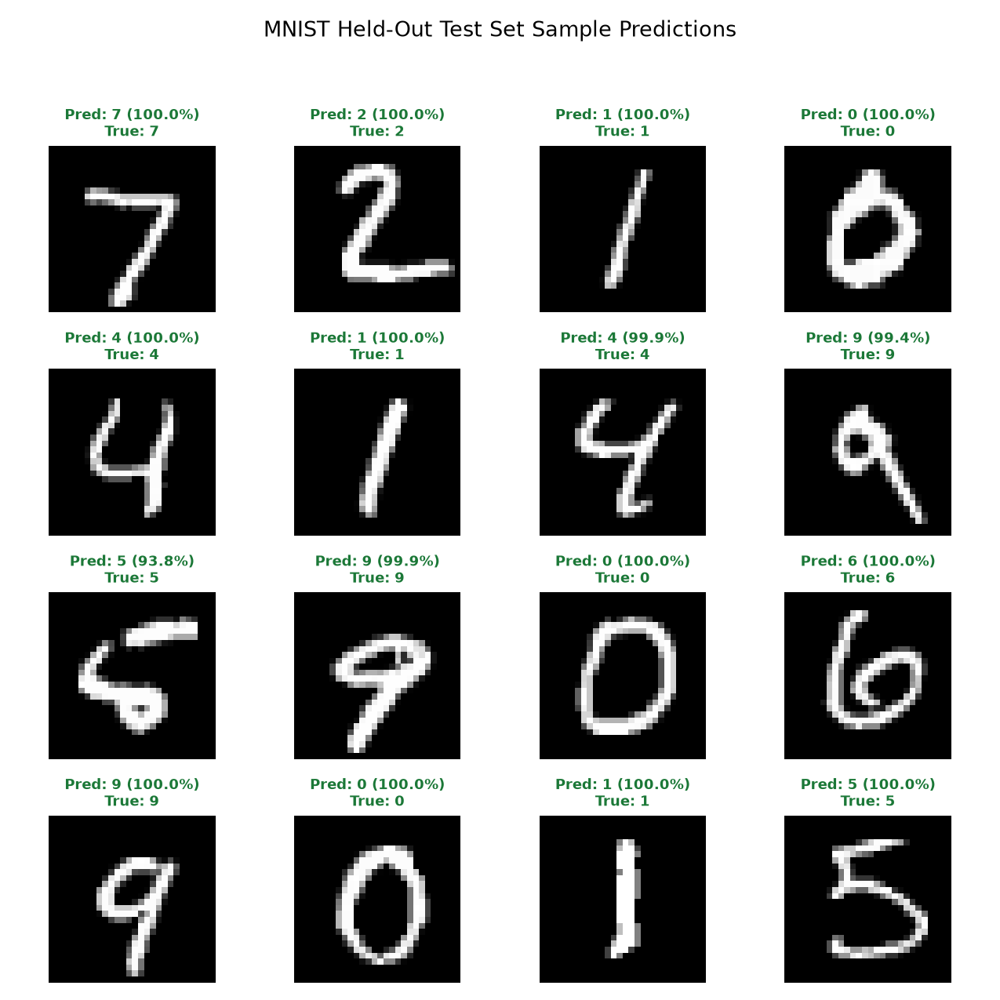

# MNIST Classification Pipeline — Evaluation & Benchmark Report

## 1. Executive Summary

- **Test Accuracy**: **98.93%** (`0.9893`)
- **Macro F1-Score**: `0.9892`
- **Test Cross-Entropy Loss**: `0.0315`
- **Evaluated Test Samples**: `10,000`
- **Trainable Parameters**: `421,834` (`4.85 MB`)
- **Execution Device**: `cpu`
- **Global Seed**: `42` (`deterministic=True`)

---

## 2. Training Progression Summary

| Epoch | Train Loss | Train Acc (%) | Val Loss | Val Acc (%) | Learning Rate | Epoch Time (s) |
| :---: | :---: | :---: | :---: | :---: | :---: | :---: |
| 1 | 0.2714 | 91.77% | 0.0747 | 97.75% | 0.001000 | 27.09 |
| 2 | 0.0937 | 97.12% | 0.0619 | 98.35% | 0.001000 | 21.88 |
| 3 | 0.0703 | 97.82% | 0.0481 | 98.62% | 0.001000 | 22.32 |
| 4 | 0.0606 | 98.16% | 0.0401 | 98.75% | 0.001000 | 21.83 |
| 5 | 0.0546 | 98.31% | 0.0430 | 98.83% | 0.001000 | 21.74 |

### Training & Validation Curves

| Training vs. Validation Loss | Training vs. Validation Accuracy |
| :---: | :---: |
|  |  |

---

## 3. Held-Out Test Set Classification Metrics

| Metric | Value |
| :--- | :---: |
| **Overall Accuracy** | `0.9893` (98.93%) |
| **Cross-Entropy Loss** | `0.0315` |
| **Macro Precision** | `0.9892` |
| **Macro Recall** | `0.9893` |
| **Macro F1-Score** | `0.9892` |
| **Weighted Precision** | `0.9893` |
| **Weighted Recall** | `0.9893` |
| **Weighted F1-Score** | `0.9893` |

### Per-Class Precision, Recall & F1-Score

| Digit Class | Precision | Recall | F1-Score | Support |
| :---: | :---: | :---: | :---: | :---: |
| **Digit 0** | 0.9858 | 0.9949 | 0.9903 | 980 |
| **Digit 1** | 0.9938 | 0.9938 | 0.9938 | 1135 |
| **Digit 2** | 0.9799 | 0.9922 | 0.9860 | 1032 |
| **Digit 3** | 0.9970 | 0.9871 | 0.9920 | 1010 |
| **Digit 4** | 0.9939 | 0.9949 | 0.9944 | 982 |
| **Digit 5** | 0.9866 | 0.9910 | 0.9888 | 892 |
| **Digit 6** | 0.9844 | 0.9906 | 0.9875 | 958 |
| **Digit 7** | 0.9883 | 0.9835 | 0.9859 | 1028 |
| **Digit 8** | 0.9887 | 0.9846 | 0.9866 | 974 |
| **Digit 9** | 0.9940 | 0.9802 | 0.9870 | 1009 |

### Confusion Matrix & Sample Predictions

| Held-Out Test Set Confusion Matrix (10x10) | Sample Predictions on Test Digits (4x4) |
| :---: | :---: |
|  |  |

---

## 4. Inference Latency & Throughput Benchmarks

| Batch Size | Mean Latency (ms) | Std (ms) | P50 (ms) | P95 (ms) | P99 (ms) | Throughput (samples/sec) |
| :---: | :---: | :---: | :---: | :---: | :---: | :---: |
| **1** | 0.330 | 0.027 | 0.328 | 0.372 | 0.395 | 3030.5 |
| **32** | 4.405 | 0.653 | 4.151 | 6.110 | 6.344 | 7263.7 |
| **128** | 11.983 | 0.418 | 11.888 | 12.649 | 13.686 | 10682.1 |

---

## 5. Runtime Environment Metadata

- **Python**: `3.12.12`
- **PyTorch**: `2.15.0`
- **Platform**: `macOS-15.2-arm64-arm-64bit`
- **Timestamp (UTC)**: `2026-11-13T17:44:23.403997+00:00`
