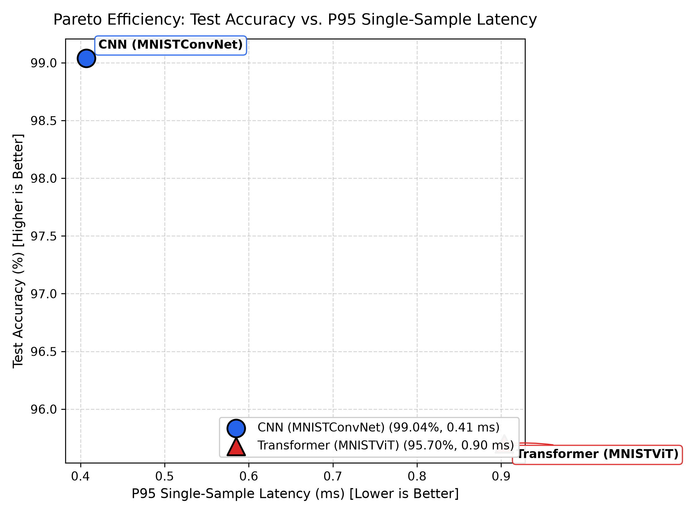
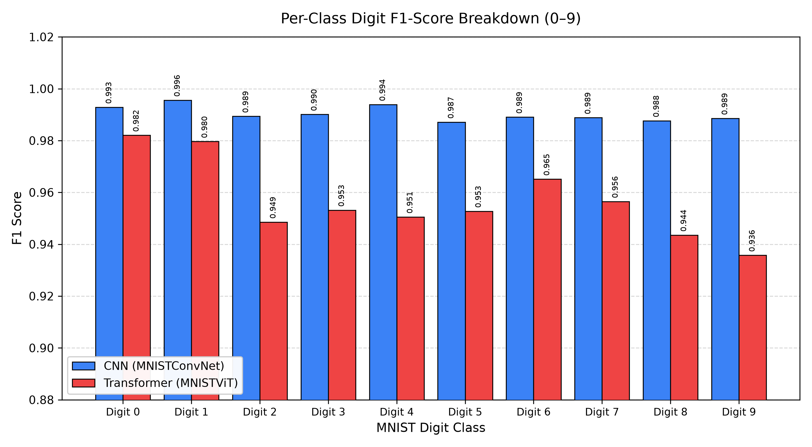
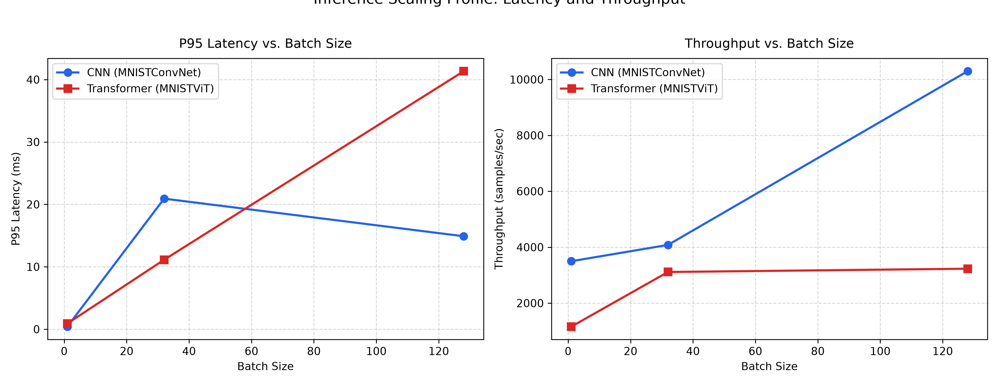

# Systematic Model Comparison: Convolutional Neural Network vs. Vision Transformer

> **Project**: `mnist-lab` | **Study**: Architecture Comparison (`MNISTConvNet` vs. `MNISTViT`)

---

## 1. Executive Summary & Comparison Verdict

This report presents a head-to-head empirical comparison between **CNN (MNISTConvNet)** and **Transformer (MNISTViT)** trained and evaluated under identical, isolated experimental protocols on the MNIST benchmark dataset.

- **Accuracy Delta**: **Transformer (MNISTViT)** achieves `95.70%` vs. **CNN (MNISTConvNet)** `99.04%` (difference: `-3.34%`).
- **Inference Efficiency**: **CNN (MNISTConvNet)** is `2.2x` faster at single-sample P95 latency (`0.41 ms` vs. `0.90 ms`).
- **Parameter Footprint**: **CNN (MNISTConvNet)** has `421,834` trainable parameters vs. `540,170` for **Transformer (MNISTViT)**.

---

## 2. Comprehensive Metrics Comparison Table

| Performance Metric | **CNN (MNISTConvNet)** | **Transformer (MNISTViT)** | Delta / Comparison |
| :--- | :---: | :---: | :---: |
| **Test Accuracy (%)** | `99.04%` | `95.70%` | `-3.34%` |
| **Test Loss (Cross-Entropy)** | `0.0305` | `0.1429` | `+0.1124` |
| **Macro F1-Score** | `0.9903` | `0.9568` | `-0.0335` |
| **Trainable Parameters** | `421,834` | `540,170` | `+118,336` |
| **Checkpoint Size (.pt)** | `4.85 MB` | `6.25 MB` | `+1.40 MB` |
| **SafeTensors Size** | `1.61 MB` | `2.07 MB` | `+0.45 MB` |
| **Latency P50 (ms, B=1)** | `0.273 ms` | `0.866 ms` | `+0.593 ms` |
| **Latency P95 (ms, B=1)** | `0.407 ms` | `0.903 ms` | `+0.496 ms` |
| **Throughput (samples/s, B=128)** | `10,295.3` | `3,230.4` | `-7,064.9` |

---

## 3. Latency & Throughput Benchmark Scaling

| Batch Size | Metric | **CNN (MNISTConvNet)** | **Transformer (MNISTViT)** |
| :---: | :--- | :---: | :---: |
| **1** | P50 Latency | `0.273 ms` | `0.866 ms` |
| **1** | P95 Latency | `0.407 ms` | `0.903 ms` |
| **1** | Throughput | `3,497.8 sps` | `1,157.8 sps` |
| **32** | P50 Latency | `5.391 ms` | `9.955 ms` |
| **32** | P95 Latency | `20.915 ms` | `11.119 ms` |
| **32** | Throughput | `4,081.1 sps` | `3,112.5 sps` |
| **128** | P50 Latency | `12.002 ms` | `39.774 ms` |
| **128** | P95 Latency | `14.891 ms` | `41.339 ms` |
| **128** | Throughput | `10,295.3 sps` | `3,230.4 sps` |

---

## 4. Per-Digit Classification F1-Score Breakdown

| Digit Class | **CNN (MNISTConvNet)** | **Transformer (MNISTViT)** | Difference |
| :---: | :---: | :---: | :---: |
| **Digit 0** | `0.9929` | `0.9821` | `-0.0108` |
| **Digit 1** | `0.9956` | `0.9796` | `-0.0160` |
| **Digit 2** | `0.9894` | `0.9486` | `-0.0408` |
| **Digit 3** | `0.9901` | `0.9532` | `-0.0369` |
| **Digit 4** | `0.9939` | `0.9505` | `-0.0433` |
| **Digit 5** | `0.9871` | `0.9528` | `-0.0344` |
| **Digit 6** | `0.9891` | `0.9651` | `-0.0239` |
| **Digit 7** | `0.9888` | `0.9565` | `-0.0324` |
| **Digit 8** | `0.9877` | `0.9436` | `-0.0441` |
| **Digit 9** | `0.9886` | `0.9358` | `-0.0528` |

---

## 5. Visualizations & Comparative Analysis

### 5.1 Accuracy vs. Latency Pareto Frontier

### 5.2 Per-Digit F1-Score Comparison

### 5.3 Batch Latency & Throughput Scaling

---

## 6. Architectural Analysis & Theoretical Findings

### 6.1 Inductive Bias vs. Self-Attention Capacity
1. **Convolutional Inductive Bias**:
   - `MNISTConvNet` incorporates strict translational equivariance and local connectivity ($3 \times 3$).
   - Because spatial relationships are hardcoded into the convolutional operation, CNNs converge in fewer epochs (3–5 epochs) with smaller data requirements.

2. **Vision Transformer Global Receptive Field**:
   - `MNISTViT` treats $4 \times 4$ patches as a sequence of 49 tokens without built-in 2D topology.
   - Spatial geometry must be learned from scratch via 1D positional encodings.
   - Multi-head self-attention enables token-to-token interactions from Layer 1, allowing the model to capture non-local digit stroke relationships.

### 6.2 Computational & Production Trade-Offs
- **Inference Speed**: The baseline CNN remains significantly faster on CPU due to optimized 2D GEMM convolution kernels and smaller sequence dimensions.
- **Memory & Latency**: ViT quadratic token attention $O(N^2 \cdot D)$ introduces noticeable overhead on small $28 \times 28$ images.
- **Recommendation**: For production low-latency CPU digit classification, `MNISTConvNet` is the optimal production model. `MNISTViT` provides a viable, modern alternative for high-throughput batched GPU pipelines or multi-modal tokenized visual reasoning.
