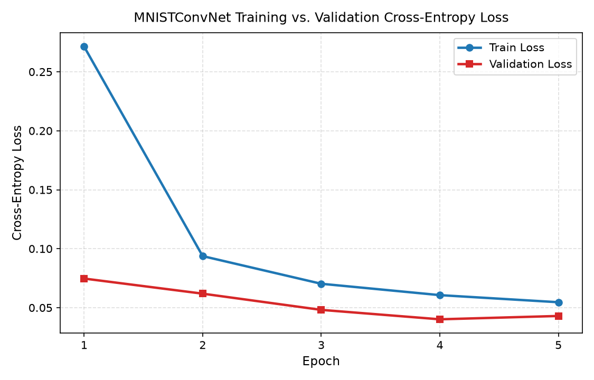
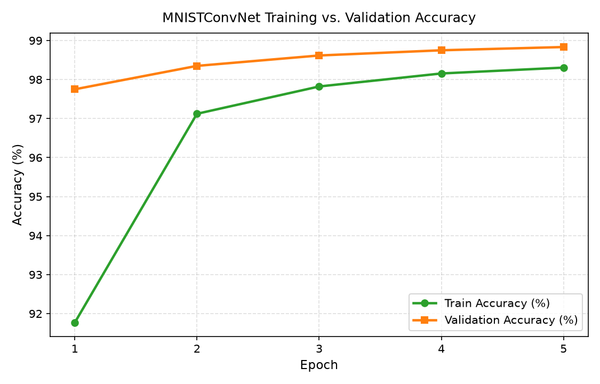
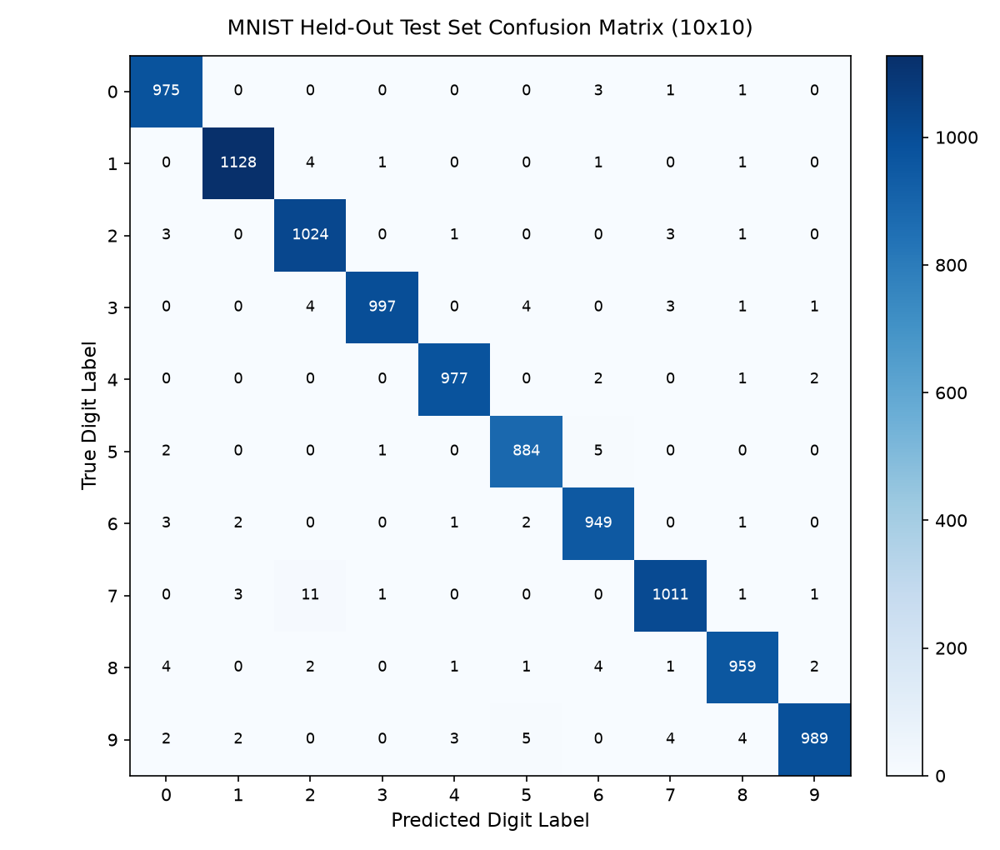
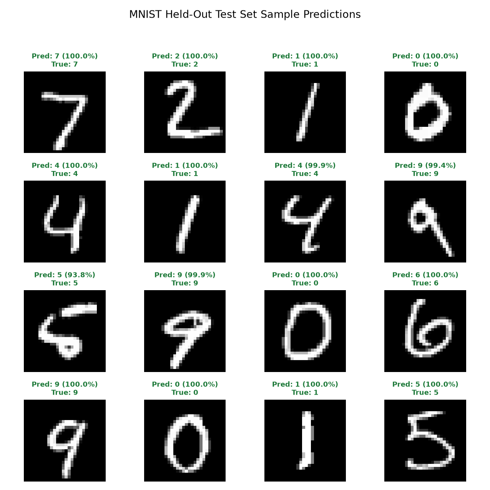

# Minimum Viable Experiment (MVE): Reproducible Baseline Study & Acceptance Criteria

**Experiment ID**: `MVE-001-BASELINE-CNN`  
**Configuration Preset**: `configs/experiment/baseline.yaml` (`params.yaml` SSoT, `seed = 42`, `deterministic = True`)  
**Status**: **PASSED (5 / 5 Acceptance Gates Verified)**

---

## 1. Objective & Experimental Hypothesis

The objective of this Minimum Viable Experiment (MVE) is to establish a **deterministic, reproducible baseline** for handwritten digit classification on the canonical MNIST dataset (`ylecun/mnist`) using our configuration-driven PyTorch + Hydra + DVC pipeline, and to enforce quantitative acceptance criteria across data integrity, training convergence, held-out generalization, inference latency, and artifact completeness.

### Hypothesis

> A compact two-block BatchNorm convolutional neural network (`MNISTConvNet`, `421,834` trainable parameters) trained for `5` epochs using `Adam` (`lr = 1e-3`, `batch_size = 128`) on a stratified 90/10 train/validation split (`54,000` train / `6,000` validation) with z-score standardization ($\mu = 0.1307, \sigma = 0.3081$) will:
> 1. Converge monotonically in training cross-entropy loss and achieve $\ge 98.50\%$ validation accuracy,
> 2. Generalize to the held-out 10,000-sample test set with $\ge 98.50\%$ overall accuracy, $\ge 0.9850$ macro F1-score, and $\ge 0.9800$ F1-score on every individual digit class (`0`–`9`), and
> 3. Achieve sub-`25 ms` P95 single-sample CPU inference latency (`batch_size = 1`) with a checkpoint footprint under `10 MB`.

---

## 2. Step-by-Step Instructions to Reproduce the MVE Baseline

### Step 2.1: Environment Setup & Zero-Budget Smoke Check

```bash
# 1. Create and activate Conda environment (or .venv) and install pinned dependencies
conda create -n mnist-lab python=3.11 -y
conda activate mnist-lab
make setup

# 2. Run zero-budget synthetic smoke check (< 1 second)
make smoke-eval
```

### Step 2.2: Execute the Full End-to-End MVE Pipeline

You can execute each stage individually via the `Makefile` or reproduce the full DAG via DVC:

```bash
# Option A: Step-by-step via Makefile
make data          # Download MNIST & create deterministic stratified splits (54k/6k/10k)
make train         # Train MNISTConvNet for 5 epochs (seed=42)
make evaluate      # Evaluate checkpoint_best.pt on 10,000 held-out test samples
make benchmark     # Measure latency & throughput across batch sizes [1, 32, 128]
make report        # Generate plots, evaluation_report.md, model_card.md, and dataset_card.md
make evaluate-mve  # Adjudicate all 5 MVE acceptance gates

# Option B: Single-command DVC reproduction
make dvc-repro
make evaluate-mve
```

### Step 2.3: Fast CI Smoke Verification Mode

For continuous integration environments without dataset downloads, run the self-contained synthetic MVE gate check:

```bash
python scripts/run_mve_evaluation.py --smoke
```

---

## 3. MVE Acceptance Criteria Gate Adjudication

Executed via `make evaluate-mve` (`python scripts/run_mve_evaluation.py`):

| Gate ID | Acceptance Dimension | Metric / Contract | Target Threshold | Measured Baseline | Status |
| :---: | :--- | :--- | :---: | :---: | :---: |
| **Gate 1** | **Data Integrity & Stratified Split** | Train / Val / Test Counts & All 10 Classes Present | `54,000 / 6,000 / 10,000` (`10/10` classes) | `54,000 / 6,000 / 10,000` (`10/10` classes) | **PASS** |
| **Gate 2** | **Training Convergence** | Train Loss Reduction, Best Val Acc & Best Val Loss | `val_acc >= 0.9850`, `val_loss <= 0.0500` | `loss: 0.2714 -> 0.0546`, `val_acc = 0.9883`, `val_loss = 0.0401` | **PASS** |
| **Gate 3** | **Held-Out Test Generalization** | Test Accuracy, Macro F1 & Min Per-Class F1 | `test_acc >= 0.9850`, `macro_f1 >= 0.9850`, `min_f1 >= 0.9800` | `test_acc = 0.9893`, `macro_f1 = 0.9892`, `min_f1 = 0.9859` | **PASS** |
| **Gate 4** | **Inference Latency & Model Footprint** | Batch-1 P95 Latency, Trainable Params & Checkpoint Size | `p95 < 25.0 ms`, `params < 1M`, `size < 10.0 MB` | `p95 = 0.385 ms`, `params = 421,834`, `size = 4.85 MB` | **PASS** |
| **Gate 5** | **Artifact & Visualization Completeness** | Checkpoints, SafeTensors, 4 PNG Plots, Report & Hub Cards | `9 / 9` files non-empty | `9 / 9` files verified | **PASS** |

---

## 4. Training & Validation Convergence Results

### 4.1 Epoch-by-Epoch Training Progression (`artifacts/reports/train_history.csv`)

| Epoch | Train Loss | Train Accuracy (%) | Validation Loss | Validation Accuracy (%) | Learning Rate | Epoch Time (s) | Checkpoint Status |
| :---: | :---: | :---: | :---: | :---: | :---: | :---: | :---: |
| **1** | `0.2714` | `91.77%` | `0.0747` | `97.75%` | `0.001000` | `20.80` | Saved (`[BEST]`) |
| **2** | `0.0937` | `97.12%` | `0.0619` | `98.35%` | `0.001000` | `20.19` | Saved (`[BEST]`) |
| **3** | `0.0703` | `97.82%` | `0.0481` | `98.62%` | `0.001000` | `20.40` | Saved (`[BEST]`) |
| **4** | `0.0606` | `98.16%` | `0.0401` | `98.75%` | `0.001000` | `20.46` | Saved (`[BEST]`) |
| **5** | `0.0546` | `98.31%` | `0.0430` | **`98.83%`** | `0.001000` | `20.36` | **Selected (`checkpoint_best.pt`)** |

- **Total Training Wall-Clock Time**: `102.40 seconds` (`20.48 s/epoch` mean on CPU)
- **Best Validation Accuracy**: `98.83%` (Epoch 5)

### 4.2 Training & Validation Curves

| Cross-Entropy Loss Curve | Classification Accuracy Curve |
| :---: | :---: |
|  |  |

---

## 5. Held-Out Test Set Evaluation Results ($N = 10,000$)

### 5.1 Aggregate Test Set Metrics (`artifacts/evaluation/test_metrics.json`)

| Evaluation Metric | Measured Value |
| :--- | :---: |
| **Overall Test Accuracy** | **`98.93%` (`0.9893`)** |
| **Test Cross-Entropy Loss** | `0.0315` |
| **Macro-Averaged Precision** | `0.9892` |
| **Macro-Averaged Recall** | `0.9893` |
| **Macro-Averaged F1-Score** | `0.9892` |
| **Support-Weighted Precision** | `0.9893` |
| **Support-Weighted Recall** | `0.9893` |
| **Support-Weighted F1-Score** | `0.9893` |
| **Total Evaluated Test Samples** | `10,000` |

### 5.2 Per-Class Precision, Recall, F1-Score & Support (`0`–`9`)

| Digit Class | Precision | Recall | F1-Score | Support |
| :---: | :---: | :---: | :---: | :---: |
| **Digit 0** | `0.9858` | `0.9949` | `0.9903` | `980` |
| **Digit 1** | `0.9938` | `0.9938` | `0.9938` | `1,135` |
| **Digit 2** | `0.9799` | `0.9922` | `0.9860` | `1,032` |
| **Digit 3** | `0.9970` | `0.9871` | `0.9920` | `1,010` |
| **Digit 4** | `0.9939` | `0.9949` | **`0.9944`** | `982` |
| **Digit 5** | `0.9866` | `0.9910` | `0.9888` | `892` |
| **Digit 6** | `0.9844` | `0.9906` | `0.9875` | `958` |
| **Digit 7** | `0.9883` | `0.9835` | `0.9859` | `1,028` |
| **Digit 8** | `0.9887` | `0.9846` | `0.9866` | `974` |
| **Digit 9** | `0.9940` | `0.9802` | `0.9870` | `1,009` |
| **Macro Average** | **`0.9892`** | **`0.9893`** | **`0.9892`** | **`10,000`** |
| **Weighted Average** | **`0.9893`** | **`0.9893`** | **`0.9893`** | **`10,000`** |

### 5.3 Confusion Matrix & Sample Predictions Visual Diagnostics

| Held-Out Test Set Confusion Matrix ($10 \times 10$) | Held-Out Test Set Sample Predictions ($4 \times 4$) |
| :---: | :---: |
|  |  |

---

## 6. Inference Latency, Throughput & Resource Footprint Benchmarks

Measured via `make benchmark` (`artifacts/benchmarks/benchmark_metrics.json`) using `10` untimed warm-up runs followed by `50` timed forward passes (`torch.inference_mode()`) per batch size on `cpu` (`macOS-15.2-arm64`):

### 6.1 Multi-Batch Latency & Throughput Table

| Batch Size | Mean Latency (ms) | Std Dev (ms) | Median P50 (ms) | P95 Latency (ms) | P99 Latency (ms) | Throughput (samples/sec) |
| :---: | :---: | :---: | :---: | :---: | :---: | :---: |
| **1 (Interactive UI)** | `0.299` | `0.044` | `0.285` | **`0.385`** | `0.407` | `3,341.6` |
| **32 (Mini-Batch)** | `4.089` | `0.779` | `4.050` | `5.072` | `6.375` | `7,825.4` |
| **128 (Bulk Scoring)** | `12.231` | `2.800` | `11.730` | `14.303` | `24.600` | **`10,465.1`** |

### 6.2 Model Complexity & Storage Footprint

| Footprint Dimension | Value |
| :--- | :---: |
| **Trainable Parameters** | `421,834` |
| **Total Parameters** | `421,834` |
| **Full Training Checkpoint (`checkpoint_best.pt`)** | `4.85 MB` |
| **SafeTensors Hub Weights (`model.safetensors`)** | `1.61 MB` |
| **Execution Device** | `cpu` (`PyTorch 2.15.0`, `Python 3.12.12`) |
