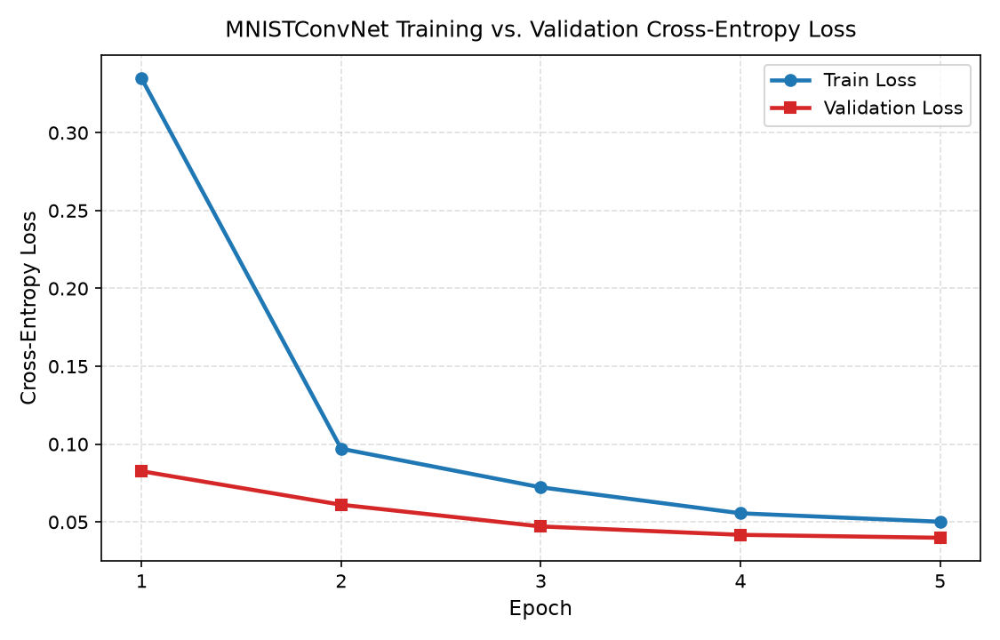
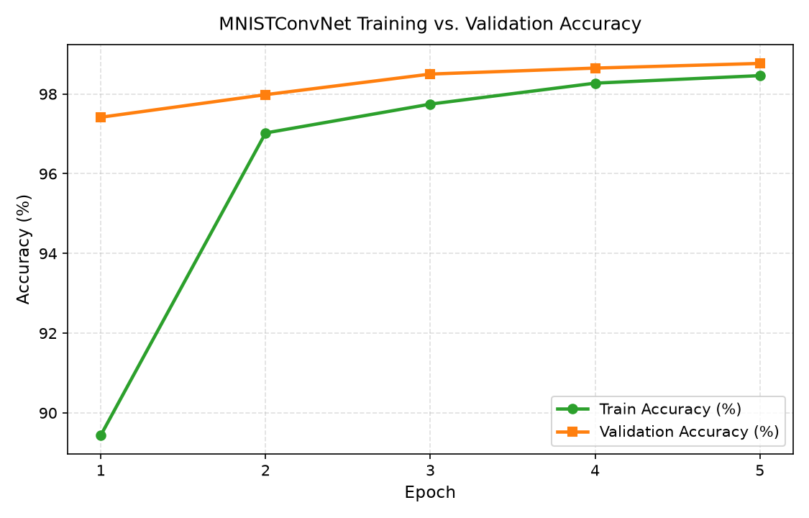
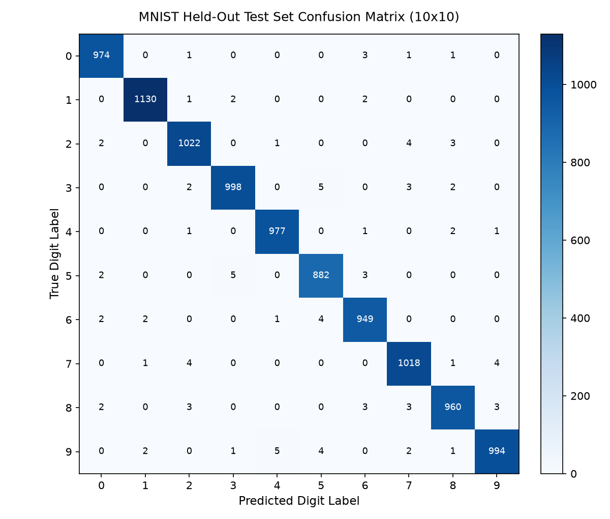
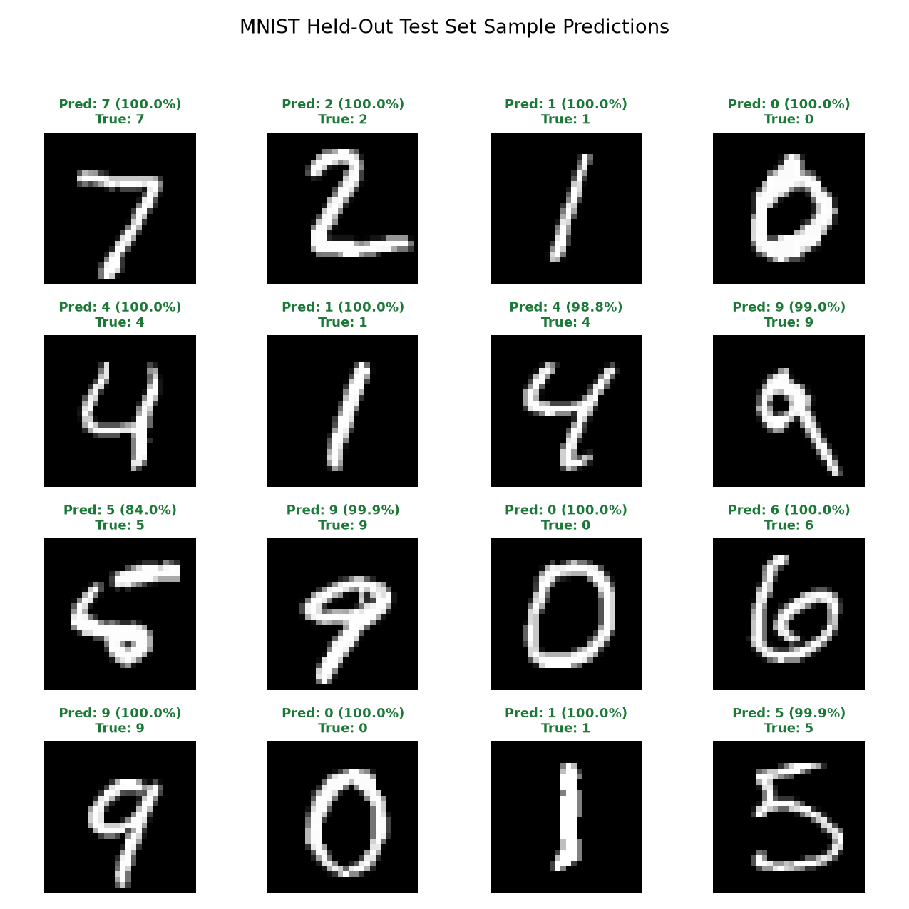

# Hyperparameter Sweep Study: Bayesian Optimization with Hyperband

**Sweep ID**: `c6dont3r`  
**W&B Dashboard**: [https://forge.coreweave.com/wandb/rl4aa/mnist-classification/sweeps/c6dont3r](https://forge.coreweave.com/wandb/rl4aa/mnist-classification/sweeps/c6dont3r)  
**Configuration File**: [`sweeps/cnn_bayes.yaml`](../../sweeps/cnn_bayes.yaml)  
**Target Metric**: `val_acc` (maximize)  
**Optimization Method**: Bayesian Search (`bayes`) + Hyperband Early Termination (`min_iter = 3`, `eta = 2`)  
**Status**: **COMPLETED (5 / 5 Trials Finished)**

---

## 1. Objective & Search Strategy

The objective of this hyperparameter sweep is to explore and optimize the architectural and training hyperparameters of the `MNISTConvNet` model on the canonical MNIST dataset (`ylecun/mnist`), aiming to maximize validation accuracy while maintaining low loss, robust generalization, and fast inference.

### Search Space & Hyperparameter Distributions

| Hyperparameter | Distribution | Search Range / Values | Target Stage |
| :--- | :---: | :---: | :---: |
| **`learning_rate`** | `log_uniform_values` | `[1e-4, 1e-2]` | `train.lr` |
| **`optimizer`** | `categorical` | `['adam', 'adamw', 'sgd']` | `train.optimizer` |
| **`dropout`** | `uniform` | `[0.1, 0.5]` | `model.dropout` |
| **`batch_size`** | `categorical` | `[64, 128, 256]` | `data.batch_size` |
| **`weight_decay`** | `log_uniform_values` | `[1e-6, 1e-3]` | `train.weight_decay` |
| **`epochs`** | `constant` | `5` | `train.epochs` |

---

## 2. 🏆 Champion Model Overview

The best-performing model identified across all executed trials is **`stellar-sweep-5`** (`run_id: lkylhv40`).

| Metric / Property | Champion Value | Description / Reference |
| :--- | :--- | :--- |
| **Trial Run Name** | `stellar-sweep-5` | W&B Run Name |
| **Run ID** | `lkylhv40` | Unique Run Identifier |
| **Validation Accuracy** | **`98.77%`** (`0.98767`) | Evaluated on 6,000 stratified validation digits |
| **Validation Loss** | **`0.0399`** | Cross-Entropy Loss on validation split |
| **Optimal Epoch** | `5` of `5` | Epoch of peak validation performance |
| **Learning Rate** | `4.7354e-04` | Adam optimizer learning rate |
| **Optimizer** | `adam` | First-order gradient optimization |
| **Dropout Rate** | `0.1976` | Feature map dropout regularization |
| **Batch Size** | `256` | Mini-batch sample size |
| **Weight Decay** | `7.6758e-04` | $L_2$ regularization penalty |
| **W&B Run URL** | [stellar-sweep-5](https://forge.coreweave.com/wandb/rl4aa/mnist-classification/runs/lkylhv40) | Cloud dashboard logs and metrics |

---

## 3. 📊 Sweep Leaderboard

All completed trials ranked by peak validation accuracy (descending), with ties broken by validation loss (ascending):

| Rank | Run Name | Run ID | Val Acc | Val Loss | Best Epoch | LR | Optimizer | Dropout | Batch Size | Weight Decay |
| :---: | :--- | :--- | :---: | :---: | :---: | :---: | :---: | :---: | :---: | :---: |
| 1 🥇 | `stellar-sweep-5` | `lkylhv40` | **`98.77%`** | `0.0399` | 5 | `4.74e-04` | `adam` | `0.198` | 256 | `7.68e-04` |
| 2 🥈 | `copper-sweep-4` | `r2009xy3` | **`98.75%`** | `0.0461` | 5 | `8.79e-04` | `adamw` | `0.442` | 128 | `4.65e-06` |
| 3 🥉 | `avid-sweep-1` | `h50ja9pk` | **`98.70%`** | `0.0443` | 4 | `7.13e-03` | `sgd` | `0.285` | 128 | `6.02e-04` |
| 4 | `spring-sweep-3` | `o1x4cay3` | **`98.62%`** | `0.0485` | 5 | `3.32e-03` | `adamw` | `0.310` | 256 | `3.22e-05` |
| 5 | `peachy-sweep-2` | `us12wo0x` | **`98.22%`** | `0.0615` | 5 | `2.48e-03` | `sgd` | `0.421` | 128 | `1.81e-04` |

---

## 4. 📈 Overall Sweep Performance Statistics

Summary distribution across the 5 search trials:

| Metric | Minimum | Mean | Maximum |
| :--- | :---: | :---: | :---: |
| **Validation Accuracy** | `98.22%` | `98.61%` | **`98.77%`** |
| **Validation Loss** | `0.0399` | `0.0481` | `0.0615` |
| **Trial Duration (s)** | `72.0s` | `78.6s` | `86.0s` |

---

## 5. Diagnostic Figures & Visualizations

Diagnostic figures generated during pipeline evaluation:

### 5.1 Training & Validation Convergence Progression

| Epoch | Train Loss | Train Accuracy (%) | Validation Loss | Validation Accuracy (%) | Learning Rate | Epoch Time (s) | Checkpoint Status |
| :---: | :---: | :---: | :---: | :---: | :---: | :---: | :---: |
| **1** | `0.3349` | `89.44%` | `0.0826` | `97.42%` | `0.000474` | `21.35` | Saved (`[BEST]`) |
| **2** | `0.0971` | `97.02%` | `0.0611` | `97.98%` | `0.000474` | `21.24` | Saved (`[BEST]`) |
| **3** | `0.0723` | `97.75%` | `0.0472` | `98.50%` | `0.000474` | `20.44` | Saved (`[BEST]`) |
| **4** | `0.0556` | `98.27%` | `0.0418` | `98.65%` | `0.000474` | `30.01` | Saved (`[BEST]`) |
| **5** | `0.0502` | `98.46%` | `0.0399` | **`98.77%`** | `0.000474` | `25.50` | **Champion (`checkpoint_best.pt`)** |

| Cross-Entropy Loss Curve | Classification Accuracy Curve |
| :---: | :---: |
|  |  |

### 5.2 Held-Out Test Evaluation & Sample Predictions

The champion model was evaluated across all 10,000 held-out test samples:
- **Test Accuracy**: **`99.04%`** (`0.9904`)
- **Macro F1-Score**: **`0.9903`**
- **Test Cross-Entropy Loss**: **`0.0305`**

| Held-Out Test Set Confusion Matrix (10x10) | Sample Predictions on Test Digits (4x4) |
| :---: | :---: |
|  |  |

---

## 6. Raw Metrics & Metadata Ledger

Detailed evaluation files and metrics stored in [`docs/experiments/metrics/`](metrics/):

- **Sweep Trial Ledger**: [`docs/experiments/metrics/sweep_c6dont3r_trials.json`](metrics/sweep_c6dont3r_trials.json)
- **Held-Out Test Metrics**: [`docs/experiments/metrics/test_metrics.json`](metrics/test_metrics.json)
- **Classification Report**: [`docs/experiments/metrics/classification_report.txt`](metrics/classification_report.txt)
- **Confusion Matrix Data**: [`docs/experiments/metrics/confusion_matrix.csv`](metrics/confusion_matrix.csv)
- **Latency & Throughput Benchmarks**: [`docs/experiments/metrics/benchmark_metrics.json`](metrics/benchmark_metrics.json)

---

## 7. Step-by-Step Instructions to Reproduce or Promote

### 7.1 Execute a New Sweep or Add Trials

```bash
# Initialize and run 5 Bayesian sweep trials
make sweep COUNT=5

# Run a single fast trial with custom parameters for debugging
make sweep-smoke
```

### 7.2 Generate or Refresh the Local Markdown Sweep Report

```bash
# Refresh report from the local trial ledger or W&B API
make sweep-report SWEEP_ID=c6dont3r
```

### 7.3 Promote Champion Model Locally

Promoting the champion model automatically updates `params.yaml`, copies the trial checkpoint to `artifacts/checkpoints/checkpoint_best.pt`, runs test evaluation and benchmarking, and re-renders documentation:

```bash
make sweep-promote SWEEP_ID=c6dont3r
```

### 7.4 Promote and Release to Hugging Face Hub

```bash
# Dry run verification (stages model card, weights & config without pushing)
make sweep-publish-hf SWEEP_ID=c6dont3r DRY_RUN=true

# Live publish to HF Hub Model Repo
make sweep-publish-hf SWEEP_ID=c6dont3r
```
