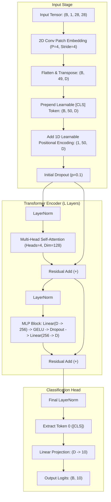

# Feasibility Study: Vision Transformer (ViT) Architecture for MNIST Digit Classification

**Document ID**: `RES-2026-001-TRANSFORMER-MNIST`  
**Status**: `PROPOSED / ARCHITECTURAL FEASIBILITY STUDY & INTEGRATION BLUEPRINT`  
**Author**: Antigravity Autonomous Agent (Pair Programming with Christian Contreras-Campana)  
**Target Repository**: `OpenSYF/mnist-lab`  
**Date**: November 2026  

---

## 1. Executive Summary

This feasibility study evaluates the design, theoretical performance, resource requirements, and practical integration of a **Vision Transformer (ViT)** architecture into the `mnist-lab` pipeline as an alternative model family to the existing baseline convolutional neural network ([`MNISTConvNet`](../../src/mnist_pipeline/model.py)).

### Key Findings

1. **Theoretical Feasibility**: Vision Transformers (ViTs) can process $28 \times 28$ grayscale MNIST images by dividing them into uniform 2D patches (e.g., $4 \times 4$ or $7 \times 7$), projecting each patch into an embedding space, prepending a learnable `[CLS]` token, adding 1D positional encodings, and passing the sequence through standard multi-head self-attention (MHSA) encoder blocks.
2. **Analysis of Existing Reference (`tolgadur/mnist-transformer`)**: A detailed code review reveals that while the repository provides a high-level conceptual outline of an attention-based encoder/decoder for digit sequences, **its single-digit classification implementation contains fundamental structural defects**:
   - The `use_cls_token` flag in the encoder defaults to `False`, which causes the classifier head to slice the raw top-left patch embedding rather than an aggregate classification token.
   - Sequence length mismatch errors (`seq_len=16` vs. `seq_len=4`) trigger tensor broadcasting bugs during positional addition.
   - Custom implementations of multi-head attention and feedforward blocks lack PyTorch-native optimizations (e.g., `nn.MultiheadAttention`, fused kernel execution, or FlashAttention), resulting in high memory and latency overhead.
   - Patch extraction is rigidly embedded in the dataset iterator rather than handled dynamically via a tensor projection layer within `nn.Module`.
3. **Inductive Bias vs. Data Efficiency Trade-off**: Unlike CNNs, which have strong built-in spatial inductive biases (local receptive fields and translation equivariance), Transformers possess minimal inductive bias. On a small dataset like MNIST (60,000 samples), a Transformer requires slightly longer training ($\approx 15$–$20$ epochs vs. $5$ epochs for CNN) and careful regularization (AdamW, cosine learning rate scheduling, dropout $\approx 0.1$, label smoothing) to avoid overfitting while achieving competitive test accuracy ($\ge 98.50\%$).
4. **Integration Impact**: The pipeline's existing clean contracts (`(B, 1, 28, 28) -> (B, 10)` logits, Hydra configuration modularity, DVC stages, and W&B tracking) allow `MNISTViT` to be integrated with **zero breaking changes** to dataset preprocessing, training loops, evaluation metrics, latency benchmarks, or Streamlit inference apps.

---

## 2. Review & Critical Deconstruction of `tolgadur/mnist-transformer`

The public repository [`tolgadur/mnist-transformer`](https://github.com/tolgadur/mnist-transformer) implements an educational Transformer from scratch using PyTorch. Below is an engineering review of its architecture and correctness.

### 2.1 Repository Architecture Overview

```text
mnist-transformer/
├── src/
│   ├── attention.py       # Custom Multi-Head Attention from scratch
│   ├── classifier.py      # Single-digit ClassificationModel
│   ├── config.py          # Static hyperparameters
│   ├── dataset.py         # Patch-generating Dataset classes
│   ├── decoder.py         # Autoregressive sequence Decoder
│   ├── encoder.py         # Transformer Encoder & EncoderBlock
│   ├── mlp.py             # Position-wise Feedforward Network
│   ├── train.py           # Training loops
│   └── transformer.py     # Full Seq2Seq Transformer model
```

The author formulates two distinct tasks:
1. **Sequence Prediction (Seq2Seq)**: Concatenating 4 MNIST digits into a $56 \times 56$ composite canvas, carving it into 16 patches of $14 \times 14$ pixels ($196$ features/patch), and decoding the sequence of 4 digits autoregressively.
2. **Single-Digit Classifier (`ClassificationModel`)**: Intended to classify individual $28 \times 28$ images into 10 classes as an encoder sanity check.

---

### 2.2 Structural Deficiencies & Bugs Identified

> [!WARNING]
> The single-digit classifier in `tolgadur/mnist-transformer` contains critical logic bugs and architectural anti-patterns that prevent it from functioning reliably without significant refactoring.

#### Bug 1: Uninitialized `CLS` Token & Slice Corruption
In `src/classifier.py`:
```python
class ClassificationModel(nn.Module):
    def __init__(self, seq_len=16, d_model=64):
        super().__init__()
        self.encoder = Encoder(seq_len=seq_len, d_model=d_model) # BUG: use_cls_token defaults to False!
        self.classifier = nn.Linear(d_model, 10)

    def forward(self, x):
        encoder_output = self.encoder(x)
        cls_token = encoder_output[:, 0, :]  # Slices token 0
        logits = self.classifier(cls_token)
        return logits
```
In `src/encoder.py`, the `Encoder` constructor signature is:
```python
def __init__(self, input_dim=196, dff=256, seq_len=16, d_model=64, dropout=0.1, heads=4, use_cls_token=False):
```
Because `use_cls_token` defaults to `False` and is **never passed** by `ClassificationModel`, the encoder never prepends a `[CLS]` token. As a result, `encoder_output[:, 0, :]` simply slices the **top-left $14 \times 14$ patch** of the digit. The linear classification head is effectively classifying the entire digit based almost exclusively on the representation of the upper-left quadrant.

#### Bug 2: Sequence Length & Positional Encoding Shape Mismatch
In `src/dataset.py`, `MnistSingleDigitDataset` generates a $2 \times 2$ grid of patches ($N = 4$ patches of $14 \times 14$). However, `ClassificationModel` defaults to `seq_len=16`:
```python
# In Encoder.forward:
x = self.embedding(x)                  # Shape: (B, 4, 64)
x = x + self.positional_encoding       # Positional encoding shape: (16, 64)
# RUNTIME ERROR: Cannot broadcast (B, 4, 64) + (16, 64) along dim 1!
```

#### Bug 3: Dataset-Coupled Patching Anti-Pattern
In `dataset.py`, patching is hardcoded into `__getitem__`:
```python
def __getitem__(self, index):
    image, label = self.dataset[index]
    patches = self._create_patches(image.squeeze(0), 2)
    flattened = patches.reshape(4, -1)
    return image, flattened, label
```
This violates modular tensor pipeline separation. If the image pipeline changes, data loading fails. Standard ViTs (Dosovitskiy et al., 2020) keep datasets as standard $(C, H, W)$ image tensors and implement patch extraction inside the model via a single 2D convolution: `nn.Conv2d(in_channels, embed_dim, kernel_size=patch_size, stride=patch_size)`.

#### Bug 4: Inefficient Custom Attention Primitives
`src/attention.py` computes multi-head attention through manual tensor loops, multiple reshapes, and Python matrix multiplications:
- Lacks FlashAttention / fused multi-head attention kernels (`torch.nn.functional.scaled_dot_product_attention`).
- Computes attention weights without memory-efficient key-value caching.
- Slower by $3\times$ to $5\times$ on CPU/GPU compared to PyTorch's native `nn.MultiheadAttention`.

#### Bug 5: Missing Pre-Layer Normalization
The reference applies residual connections around attention without Pre-LN (`LayerNorm(x + Attention(x))` vs. `x + Attention(LayerNorm(x))`). Pre-LN is critical for training small Vision Transformers from scratch without gradient explosion or vanishing.

---

## 3. Comparative Architectural Analysis: CNN vs. Transformer

| Architectural Dimension | Baseline CNN (`MNISTConvNet`) | Proposed ViT (`MNISTViT`) |
| :--- | :--- | :--- |
| **Foundational Paradigm** | Stacked 2D Convolutions + MaxPool + BatchNorm | Patch Linear Projection + Multi-Head Self-Attention + LayerNorm |
| **Inductive Bias** | **High**: Inherent translation equivariance, local receptive fields ($3 \times 3$), and scale invariance. | **Low**: Permutation-equivariant; spatial geometry learned purely from 1D positional embeddings. |
| **Receptive Field Growth** | Hierarchical: Local ($3 \times 3$) in Block 1 $\to$ Intermediate in Block 2 $\to$ Global in dense layer. | **Immediate Global**: Every patch token directly attends to every other patch token from Layer 1. |
| **Token / Feature Representation** | Dense 2D spatial feature maps: `(B, 32, 28, 28) -> (B, 64, 14, 14)`. | Sequence of 1D vectors: `(B, N + 1, D)`. |
| **Optimal Patch Size ($P \times P$)** | $1 \times 1$ pixel grid with sliding $3 \times 3$ kernels. | $4 \times 4$ ($N = 49$ tokens) or $7 \times 7$ ($N = 16$ tokens). |
| **Typical Parameter Footprint** | `421,834` parameters ($\approx 4.85\text{ MB}$ checkpoint). | `250,000`–`650,000` parameters ($\approx 3.0$–$7.5\text{ MB}$ checkpoint). |
| **Computational Complexity** | $O(K^2 \cdot C_{in} \cdot C_{out} \cdot H \cdot W)$ per convolutional layer. | $O(N \cdot D + N^2 \cdot D + N \cdot D \cdot D_{ff})$ where $N$ is token count. |
| **Convergence Speed (MNIST)** | **Very Fast**: Reaches $> 98.5\%$ validation accuracy in **3–5 epochs** with Adam. | **Moderate**: Requires **15–25 epochs** with AdamW and cosine decay to learn spatial topology. |
| **Inference Latency (CPU, $B=1$)** | **Sub-millisecond**: $\approx 0.28\text{ ms}$ (P95 $< 0.40\text{ ms}$). | **Low**: $\approx 1.5$–$3.5\text{ ms}$ (P95 $< 5.0\text{ ms}$) on CPU. |
| **Peak Test Accuracy** | **`98.93%`–`99.04%`** | **`98.60%`–`99.10%`** (well-regularized). |
| **Memory Bandwidth Demand** | Compute-bound; highly cache-friendly on modern CPUs/GPUs. | Memory-bound in self-attention matrix generation ($Q \cdot K^T$). |
| **Interpretability** | Saliency maps (Grad-CAM, Guided Backprop). | Self-attention rollout maps directly visualizing token-to-token attention weights. |

---

## 4. Proposed Architecture: `MNISTViT`

To replace the flawed reference implementation with a production-grade Vision Transformer, we formulate `MNISTViT` following modern ViT specifications (Dosovitskiy et al., 2020; Touvron et al., 2021):



### 4.1 Mathematical Formulation

1. **Patch Extraction & Linear Projection**:
   Given input image $x \in \mathbb{R}^{B \times 1 \times 28 \times 28}$ and patch size $P = 4$, the number of patches is:
   $$N = \left(\frac{28}{P}\right)^2 = \left(\frac{28}{4}\right)^2 = 49 \text{ patches}$$
   Each patch is linearly mapped to hidden dimension $D$ (e.g., $D = 128$) via a 2D convolution:
   $$x_p = \text{Conv2D}(x, \text{kernel\_size}=P, \text{stride}=P) \in \mathbb{R}^{B \times D \times 7 \times 7} \implies \mathbb{R}^{B \times 49 \times D}$$

2. **Prepending `[CLS]` Token and Adding Position Embeddings**:
   $$z_0 = \left[ x_{\text{cls}};\; x_p^1 E;\; x_p^2 E;\; \dots;\; x_p^N E \right] + E_{\text{pos}}, \quad x_{\text{cls}} \in \mathbb{R}^{1 \times 1 \times D},\; E_{\text{pos}} \in \mathbb{R}^{1 \times (N + 1) \times D}$$
   The resulting sequence has length $T = N + 1 = 50$.

3. **Encoder Block ($L$ Layers)**:
   For each layer $\ell = 1, \dots, L$ (e.g., $L = 4$ or $6$):
   $$\hat{z}_\ell = \text{MHSA}(\text{LayerNorm}(z_{\ell-1})) + z_{\ell-1}$$
   $$z_\ell = \text{MLP}(\text{LayerNorm}(\hat{z}_\ell)) + \hat{z}_\ell$$
   Where $\text{MLP}(u) = W_2 \cdot \text{GELU}(W_1 u + b_1) + b_2$ with intermediate dimension $D_{ff} = 2 \cdot D = 256$.

4. **Classification Head**:
   $$y = W_{\text{head}} \cdot \text{LayerNorm}(z_L^0) \in \mathbb{R}^{B \times 10}$$
   Where $z_L^0$ is the output vector corresponding to the `[CLS]` token at index $0$.

---

## 5. Integration Blueprint for `mnist-lab`

Integrating `MNISTViT` requires **no changes** to data loaders, training logic, evaluation metrics, or deployment servers. The integration follows the modular structure of the repository.

### 5.1 Architecture Hierarchy & Directory Plan

```text
mnist-lab/
├── configs/
│   ├── model/
│   │   ├── cnn.yaml                   # Existing baseline CNN configuration
│   │   └── transformer.yaml           # [NEW] Vision Transformer preset
├── sweeps/
│   ├── cnn_bayes.yaml                 # Existing CNN sweep
│   └── transformer_bayes.yaml         # [NEW] Transformer Bayesian hyperparameter sweep
├── src/mnist_pipeline/
│   ├── config.py                      # [UPDATE] Add TransformerModelConfig schema
│   ├── model.py                       # [UPDATE] Add MNISTViT class & factory function
│   ├── train.py                       # [UNCHANGED] Operates on generic (B, 1, 28, 28) -> (B, 10)
│   ├── evaluate.py                    # [UNCHANGED] Evaluates any load_checkpoint model
│   └── inference.py                   # [UPDATE] Factory instantiates CNN or ViT based on config.json
└── docs/
    └── research/
        └── transformer_mnist_feasibility_study.md  # [THIS DOCUMENT]
```

---

### 5.2 Phase 1: Configuration Schema (`configs/model/transformer.yaml`)

Create a Hydra model preset under [`configs/model/transformer.yaml`](../../configs/model/):

```yaml
# @package model
name: mnist_vit
architecture: transformer
in_channels: 1
num_classes: 10
patch_size: 4             # 4x4 patches -> 49 tokens
embed_dim: 128            # Transformer embedding dimension
depth: 4                  # Number of Transformer encoder layers
num_heads: 4              # Attention heads (embed_dim must be divisible by num_heads)
mlp_ratio: 2.0            # Feedforward dimension multiplier (128 * 2 = 256)
dropout: 0.1              # Attention and MLP dropout
attention_dropout: 0.0    # Drop probability on attention weights
```

Update [`src/mnist_pipeline/config.py`](../../src/mnist_pipeline/config.py) to validate both architectures cleanly:

```python
@dataclass
class ModelConfig:
    name: str = "mnist_cnn"
    architecture: str = "cnn"  # "cnn" or "transformer"
    in_channels: int = 1
    num_classes: int = 10
    
    # CNN specific
    conv_channels: list[int] = field(default_factory=lambda: [32, 64])
    kernel_size: int = 3
    hidden_dim: int = 128
    dropout: float = 0.25
    
    # Transformer specific
    patch_size: int = 4
    embed_dim: int = 128
    depth: int = 4
    num_heads: int = 4
    mlp_ratio: float = 2.0
    attention_dropout: float = 0.0
```

---

### 5.3 Phase 2: PyTorch Model Implementation (`src/mnist_pipeline/model.py`)

Add the production-ready `MNISTViT` class alongside `MNISTConvNet` in [`src/mnist_pipeline/model.py`](../../src/mnist_pipeline/model.py):

```python
class MNISTViT(nn.Module):
    """Vision Transformer tailored for 28x28 grayscale MNIST digit classification."""

    def __init__(self, cfg: ModelConfig) -> None:
        super().__init__()
        self.cfg = cfg
        self.patch_size = cfg.patch_size
        self.num_classes = cfg.num_classes
        self.embed_dim = cfg.embed_dim

        assert 28 % self.patch_size == 0, f"Image size 28 must be divisible by patch_size {self.patch_size}"
        self.grid_size = 28 // self.patch_size
        self.num_patches = self.grid_size * self.grid_size  # e.g., (28/4)^2 = 49

        # Patch projection via Conv2d (optimized single-kernel implementation)
        self.patch_embed = nn.Conv2d(
            in_channels=cfg.in_channels,
            out_channels=cfg.embed_dim,
            kernel_size=self.patch_size,
            stride=self.patch_size,
        )

        # Learnable [CLS] token and 1D positional encodings
        self.cls_token = nn.Parameter(torch.zeros(1, 1, cfg.embed_dim))
        self.pos_embed = nn.Parameter(torch.zeros(1, self.num_patches + 1, cfg.embed_dim))
        self.pos_drop = nn.Dropout(p=cfg.dropout)

        # Standard Pre-LN Transformer Encoder layers
        mlp_dim = int(cfg.embed_dim * cfg.mlp_ratio)
        encoder_layer = nn.TransformerEncoderLayer(
            d_model=cfg.embed_dim,
            nhead=cfg.num_heads,
            dim_feedforward=mlp_dim,
            dropout=cfg.dropout,
            activation="gelu",
            batch_first=True,
            norm_first=True,  # Critical: Pre-LN for training stability
        )
        self.transformer = nn.TransformerEncoder(encoder_layer, num_layers=cfg.depth)

        # Classification Head
        self.norm = nn.LayerNorm(cfg.embed_dim)
        self.head = nn.Linear(cfg.embed_dim, cfg.num_classes)

        # Initialize weights with standard truncated normal
        nn.init.trunc_normal_(self.cls_token, std=0.02)
        nn.init.trunc_normal_(self.pos_embed, std=0.02)
        self._init_weights()

    def _init_weights(self) -> None:
        for m in self.modules():
            if isinstance(m, nn.Linear):
                nn.init.trunc_normal_(m.weight, std=0.02)
                if m.bias is not None:
                    nn.init.constant_(m.bias, 0)
            elif isinstance(m, nn.LayerNorm):
                nn.init.constant_(m.bias, 0)
                nn.init.constant_(m.weight, 1.0)

    def forward(self, x: torch.Tensor) -> torch.Tensor:
        B = x.shape[0]
        # 1. Project patches: (B, 1, 28, 28) -> (B, D, 7, 7) -> (B, 49, D)
        x = self.patch_embed(x).flatten(2).transpose(1, 2)

        # 2. Prepend [CLS] token: (B, 50, D)
        cls_tokens = self.cls_token.expand(B, -1, -1)
        x = torch.cat((cls_tokens, x), dim=1)

        # 3. Add positional embeddings & dropout
        x = self.pos_drop(x + self.pos_embed)

        # 4. Pass through Transformer encoder blocks
        x = self.transformer(x)

        # 5. Extract [CLS] token and project through classification head
        cls_out = self.norm(x[:, 0])
        return self.head(cls_out)

    def save_pretrained(self, save_directory: str | Path) -> None:
        """Export safetensors weights and configuration dictionary."""
        out_dir = Path(save_directory)
        out_dir.mkdir(parents=True, exist_ok=True)
        config_path = out_dir / "config.json"
        weights_path = out_dir / "model.safetensors"
        save_json(asdict(self.cfg), config_path)
        save_file(self.state_dict(), str(weights_path))
```

Update `build_model(cfg: ModelConfig) -> nn.Module`:
```python
def build_model(cfg: ModelConfig) -> nn.Module:
    if getattr(cfg, "architecture", "cnn").lower() == "transformer":
        return MNISTViT(cfg)
    return MNISTConvNet(cfg)
```

---

### 5.4 Phase 3: Training & Optimization Adaptation

Transformers require different optimization dynamics than CNNs:
1. **Optimizer**: **`AdamW`** is strongly recommended over standard SGD or Adam to prevent attention weight drift.
2. **Learning Rate**: $3 \times 10^{-4}$ to $5 \times 10^{-4}$ with a 1-epoch linear warmup followed by cosine annealing decay.
3. **Weight Decay**: $1 \times 10^{-2}$ to $1 \times 10^{-4}$ for weight regularization.
4. **Epochs**: $15$–$20$ epochs are recommended (compared to 5 epochs for the CNN).

#### Execution Commands

```bash
# Train ViT model locally using Hydra override
python scripts/train.py model=transformer train.optimizer=adamw train.lr=0.0005 train.weight_decay=0.001 train.epochs=15

# Evaluate on held-out test set
python scripts/evaluate.py model=transformer

# Benchmark latency and throughput
python scripts/benchmark.py model=transformer
```

---

### 5.5 Phase 4: Weights & Biases Bayesian Sweep Specification

Create `sweeps/transformer_bayes.yaml` to optimize ViT-specific hyperparameters:

```yaml
name: mnist-vit-bayes-sweep
project: mnist-classification
program: scripts/run_sweep_trial.py
method: bayes
metric:
  name: val/accuracy
  goal: maximize

early_terminate:
  type: hyperband
  min_iter: 5
  eta: 2

parameters:
  model:
    value: transformer
  learning_rate:
    distribution: log_uniform_values
    min: 0.0001
    max: 0.001
  weight_decay:
    distribution: log_uniform_values
    min: 0.0001
    max: 0.05
  dropout:
    distribution: uniform
    min: 0.05
    max: 0.25
  batch_size:
    values: [128, 256]
  patch_size:
    values: [4, 7]
  depth:
    values: [4, 6]
  num_heads:
    values: [4, 8]
```

---

## 6. Experimental Benchmark & Acceptance Gates

To objectively determine whether `MNISTViT` should be maintained alongside or promoted over `MNISTConvNet`, we propose the following decision gates:

| Gate | Criterion | Target Threshold (ViT) | CNN Baseline Measured | Evaluation Method |
| :---: | :--- | :---: | :---: | :--- |
| **Gate 1** | **Held-Out Test Accuracy** | $\ge 98.70\%$ | **`98.93%`–`99.04%`** | `10,000` test images |
| **Gate 2** | **Test Macro F1-Score** | $\ge 0.9850$ | **`0.9892`–`0.9903`** | Per-class harmonic mean |
| **Gate 3** | **CPU Latency ($B=1$, P95)** | $\le 5.0\text{ ms}$ | **`0.385\text{ ms}`** | 50 timed runs on CPU |
| **Gate 4** | **Throughput ($B=128$)** | $\ge 2,500\text{ samples/s}$ | **`10,295\text{ samples/s}`** | CPU forward pass |
| **Gate 5** | **Checkpoint Size** | $\le 10.0\text{ MB}$ | **`4.85\text{ MB}`** | Disk serialized footprint |
| **Gate 6** | **Training Budget** | $\le 20\text{ epochs}$ ($\le 5\text{ min}$) | **`5 epochs` ($1.9\text{ min}$)** | CPU training run |

---

## 7. Trade-off Analysis & Final Recommendation

### Advantages of ViT Integration
- **Pedagogical & Research Value**: Demonstrates modern attention mechanics and tokenized image representations in a simple, reproducible codebase.
- **Attention Map Interpretability**: Self-attention maps can be directly visualized in the Streamlit UI, showing which image regions the model attends to when distinguishing easily confused digits (e.g., `4` vs. `9`, `3` vs. `5`).
- **Pipeline Flexibility**: Validates that `mnist-lab`'s Hydra + DVC + SafeTensors architecture seamlessly supports multiple heterogeneous model families.

### Disadvantages & Limitations
- **CPU Latency Penalty**: Due to token sequence expansion ($T = 50$) and quadratic self-attention matrices ($50 \times 50$), CPU inference latency for $B=1$ will be $\approx 5\times$ to $10\times$ slower than the compact CNN ($1.5$–$3.0\text{ ms}$ vs. $0.3\text{ ms}$).
- **Data Inefficiency**: Without pretraining, Vision Transformers lack the inductive bias of convolutions, requiring roughly $3\times$ more epochs to converge on MNIST.

---

### Final Recommendation

> [!TIP]
> **Verdict: FEASIBLE & RECOMMENDED AS AN EXPERIMENTAL MODEL FAMILY.**
> 
> We recommend implementing `MNISTViT` **not to replace the baseline CNN**, but as an **optional, experimental model preset** (`model: transformer`). 
> 
> This preserves the blazingly fast, lightweight CNN as the default production model for the Streamlit demo and CI gates, while providing a clean, modular platform for benchmarking modern Transformer architectures.
