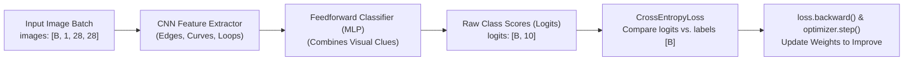

# Understanding Feedforward & Convolutional Neural Networks and the PyTorch Training Loop

> **Target Audience**: Developers, students, or scientists who are new to deep learning and PyTorch and want a clear, intuitive, first-principles explanation of how **Feedforward Neural Networks (MLPs)** and **Convolutional Neural Networks (CNNs)** work—and how our project's training loop in [`src/mnist_pipeline/train.py`](../../src/mnist_pipeline/train.py) teaches a model to recognize handwritten digits (`0`–`9`).

---

## Table of Contents

1. [The Big Picture: Multi-Class Image Classification](#1-the-big-picture-multi-class-image-classification)
2. [From Feedforward Networks (MLPs) to Convolutional Networks (CNNs)](#2-from-feedforward-networks-mlps-to-convolutional-networks-cnns)
3. [Setting the Stage: Model, Optimizer, and Loss Criterion (`lines 254–256`)](#3-setting-the-stage-model-optimizer-and-loss-criterion-lines-254256)
4. [The Heartbeat of Deep Learning: The 5-Step PyTorch Training Loop](#4-the-heartbeat-of-deep-learning-the-5-step-pytorch-training-loop)
5. [Heavily Annotated Walkthrough of `run_train_epoch` (`lines 137–159`)](#5-heavily-annotated-walkthrough-of-run_train_epoch-lines-137159)
6. [Line-by-Line Deep Dive: What PyTorch Is Doing Under the Hood](#6-line-by-line-deep-dive-what-pytorch-is-doing-under-the-hood)
7. [Training Mode vs. Evaluation Mode (`model.train()` vs. `model.eval()`)](#7-training-mode-vs-evaluation-mode-modeltrain-vs-modeleval)
8. [Summary Cheat Sheet](#8-summary-cheat-sheet)

---

## 1. The Big Picture: Multi-Class Image Classification

In our MNIST project, the goal is **10-class image classification**:
- **Input ($x$)**: A grayscale image of a handwritten digit, represented as a $28 \times 28$ grid of normalized numbers (a tensor of shape `[1, 28, 28]` for a single image, or `[B, 1, 28, 28]` for a mini-batch of `B` images).
- **Ground-Truth Label ($y$)**: An integer in `{0, 1, 2, 3, 4, 5, 6, 7, 8, 9}` telling us which digit a human actually wrote.
- **Model Output ($\hat{y}$ / `logits`)**: For each image, the neural network outputs **10 raw scores** (called **logits**), one for each candidate digit class `0` through `9`. The class with the highest score is the model's prediction.



At the start of training, the network's weights (adjustable numbers inside its layers) are initialized randomly, so its 10 output scores are pure guesswork (~10% accuracy). **Training** is the iterative process of showing the network batches of labeled images, measuring how wrong its guesses are, and slightly nudging its weights so it makes better guesses next time.

---

## 2. From Feedforward Networks (MLPs) to Convolutional Networks (CNNs)

Our model [`MNISTConvNet`](../../src/mnist_pipeline/model.py) (defined in `src/mnist_pipeline/model.py`) is a hybrid of two foundational neural network building blocks:
1. **A Convolutional Neural Network (CNN) trunk** (`self.features`), followed by
2. **A Feedforward Neural Network (Multi-Layer Perceptron / MLP) head** (`self.classifier`).

Why do we use both? Let's understand each one.

### 2.1 Feedforward Neural Networks (Multi-Layer Perceptrons / MLPs)

A **Feedforward Neural Network** is the simplest type of neural network. Information flows strictly forward—from inputs, through one or more "hidden" layers, to the outputs—without loops.

Its core building block is the **Linear (Fully Connected) Layer** (`nn.Linear(in_features, out_features)`):
- Every input number $x_i$ is connected to every output neuron $z_j$ by a learnable **weight** $W_{ji}$, plus a learnable **bias** $b_j$:
  $$z = W x + b$$
- After the linear math, we apply a non-linear **Activation Function**—most commonly **ReLU** (`nn.ReLU()`, which computes $\max(0, z)$). Without non-linear activations, stacking multiple linear layers would mathematically collapse into a single linear equation and could never learn complex patterns.

**Why a pure Feedforward Network struggles on raw images**:
If you flatten a $28 \times 28$ image into a 1D vector of $784$ pixels and feed it directly into an MLP:
1. **It destroys 2D spatial structure**: Pixels that are vertical neighbors in the image (row 5, col 10 and row 6, col 10) are treated no differently than pixels at opposite corners.
2. **No translation invariance**: If a digit `"7"` shifts 2 pixels to the left, different input neurons fire, and a pure MLP has to learn to recognize `"7"` all over again at that new position.

### 2.2 Convolutional Neural Networks (CNNs)

A **Convolutional Neural Network (CNN)** solves this by operating directly on the 2D grid `[Channels, Height, Width]`:

1. **Convolutional Layer (`nn.Conv2d`)**: Instead of connecting every pixel to every neuron, a `Conv2d` layer slides small learnable $3 \times 3$ filters (kernels) across the $28 \times 28$ image.
   - Because the *exact same* $3 \times 3$ filter slides over the entire image (**weight sharing**), a filter that learns to detect a horizontal top bar (like in a `"7"` or `"5"`) will detect it anywhere in the image.
   - **Block 1** (`1 -> 32` channels) learns low-level primitives: edges, corners, and stroke orientations.
   - **Block 2** (`32 -> 64` channels) combines those edges into higher-level shapes: loops (in `"0"`, `"6"`, `"8"`, `"9"`), intersections (in `"4"`, `"8"`), and sharp angles (in `"1"`, `"7"`).
2. **Batch Normalization (`nn.BatchNorm2d`)**: Keeps the intermediate activations centered and scaled across each mini-batch so gradients flow smoothly and training converges much faster.
3. **Max Pooling (`nn.MaxPool2d(2, 2)`)**: Shrinks the spatial grid by half ($28 \times 28 \rightarrow 14 \times 14 \rightarrow 7 \times 7$) by keeping only the strongest activation in each $2 \times 2$ window. This reduces computation and makes the network insensitive to tiny pixel shifts.

### 2.3 How `MNISTConvNet` Combines CNN + Feedforward Layers

Once the two CNN blocks have distilled the `[B, 1, 28, 28]` raw pixels into `[B, 64, 7, 7]` high-level spatial feature maps, we **flatten** those features into a vector of length $64 \times 7 \times 7 = 3,136$ and hand them to a **Feedforward Classifier (`self.classifier`)**:

```python
# Simplified view of MNISTConvNet in src/mnist_pipeline/model.py
self.features = nn.Sequential(
    # --- CNN Block 1: [B, 1, 28, 28] -> [B, 32, 14, 14] ---
    nn.Conv2d(1, 32, kernel_size=3, padding=1),
    nn.BatchNorm2d(32),
    nn.ReLU(inplace=True),
    nn.MaxPool2d(kernel_size=2, stride=2),
    # --- CNN Block 2: [B, 32, 14, 14] -> [B, 64, 7, 7] ---
    nn.Conv2d(32, 64, kernel_size=3, padding=1),
    nn.BatchNorm2d(64),
    nn.ReLU(inplace=True),
    nn.MaxPool2d(kernel_size=2, stride=2),
)

self.classifier = nn.Sequential(
    # --- Feedforward (MLP) Head: [B, 64, 7, 7] -> [B, 10] ---
    nn.Flatten(),                  # Reshape [B, 64, 7, 7] -> [B, 3136]
    nn.Dropout(p=0.25),            # Randomly zero 25% of neurons during training to prevent memorization
    nn.Linear(3136, 128),          # Hidden feedforward layer: 3136 -> 128 features
    nn.ReLU(inplace=True),         # Non-linear activation
    nn.Dropout(p=0.25),            # Regularization before final decision
    nn.Linear(128, 10),            # Output layer: 128 -> 10 class logits (digits 0..9)
)
```

In total, our `MNISTConvNet` has **421,834 trainable parameters** (weights and biases).

---

## 3. Setting the Stage: Model, Optimizer, and Loss Criterion (`lines 254–256`)

Before the training loop begins, [`train_model()`](../../src/mnist_pipeline/train.py#L254-L256) in `src/mnist_pipeline/train.py` instantiates the three core objects required for any PyTorch supervised learning pipeline:

```python
# src/mnist_pipeline/train.py (lines 254–256)
model = MNISTConvNet(cfg.model).to(device)
optimizer = build_optimizer(model, cfg.train)
criterion = nn.CrossEntropyLoss()
```

### 1. `model = MNISTConvNet(cfg.model).to(device)` — *The Brain*
- Creates the neural network with all its convolutional and linear layers (`421,834` learnable parameters).
- `.to(device)` moves all weight and bias tensors onto the target compute hardware (`"cpu"`, `"cuda"` for NVIDIA GPUs, or `"mps"` for Apple Silicon GPUs). **Crucial PyTorch Rule**: Both the model weights and the input image tensors must live on the *same* `device`, or PyTorch will raise a `RuntimeError`.

### 2. `optimizer = build_optimizer(model, cfg.train)` — *The Teacher's Wrench*
- Under the hood (lines 106–108 of `train.py`), this calls:
  ```python
  torch.optim.Adam(model.parameters(), lr=cfg.lr, weight_decay=cfg.weight_decay)
  ```
- Notice we pass `model.parameters()` to the optimizer! This gives the optimizer a direct reference to every learnable weight and bias tensor inside `model`.
- The optimizer's job is to update those parameters using their computed gradients (`param.grad`) scaled by the **learning rate** (`lr = 0.001`).

### 3. `criterion = nn.CrossEntropyLoss()` — *The Grading Rubric*
- How do we measure how good or bad the model's 10 output `logits` are compared to the true digit `labels`?
- For multi-class classification, we use **Cross-Entropy Loss** (`nn.CrossEntropyLoss()`), which internally performs two steps in a numerically stable way:
  1. **Softmax**: Converts the 10 raw, unbounded `logits` $(z_0, z_1, \dots, z_9)$ into a valid probability distribution $(p_0, p_1, \dots, p_9)$ where each $p_c \in (0, 1)$ and $\sum_{c=0}^9 p_c = 1$:
     $$p_c = \frac{e^{z_c}}{\sum_{k=0}^{9} e^{z_k}}$$
  2. **Negative Log-Likelihood**: Looks up the probability $p_y$ assigned to the **true** digit class $y$ and computes:
     $$\mathcal{L} = -\ln(p_y)$$
- **Intuition**:
  - If the true label is `y = 7` and the model assigns $p_7 = 0.99$ (99% confident it's a 7), then $\mathcal{L} = -\ln(0.99) \approx 0.010$ (**tiny loss = great prediction**).
  - If the model assigns $p_7 = 0.01$ (1% confident it's a 7), then $\mathcal{L} = -\ln(0.01) \approx 4.605$ (**huge loss = heavy penalty**).

---

## 4. The Heartbeat of Deep Learning: The 5-Step PyTorch Training Loop

Every mini-batch iteration in PyTorch follows the **exact same 5-step ritual** (`lines 149–153` of `src/mnist_pipeline/train.py`):

```python
optimizer.zero_grad(set_to_none=True)        # 1. Clear old gradients from the previous batch
logits = model(images)                       # 2. Forward Pass: compute predictions (logits)
loss: torch.Tensor = criterion(logits, labels) # 3. Compute Loss: measure error vs. true labels
loss.backward()                              # 4. Backward Pass (Backprop): compute gradients d(loss)/d(weights)
optimizer.step()                             # 5. Optimizer Step: update weights using gradients
```

```mermaid
sequenceDiagram
    participant Data as DataLoader (Mini-Batch)
    participant Opt as Optimizer (Adam)
    participant Model as MNISTConvNet (Weights θ)
    participant Loss as CrossEntropyLoss

    Data->>Model: images [B, 1, 28, 28], labels [B]
    Opt->>Model: 1. optimizer.zero_grad() (Reset θ.grad = None)
    Model->>Model: 2. logits = model(images) (Forward Pass -> [B, 10])
    Model->>Loss: 3. loss = criterion(logits, labels) (Scalar Error)
    Loss->>Model: 4. loss.backward() (Backprop populates θ.grad)
    Opt->>Model: 5. optimizer.step() (Update θ ← θ - lr * update(θ.grad))
```

---

## 5. Heavily Annotated Walkthrough of `run_train_epoch` (`lines 137–159`)

Below is the exact code from [`run_train_epoch`](../../src/mnist_pipeline/train.py#L137-L159) in `src/mnist_pipeline/train.py`, expanded with inline educational comments explaining what every single line does and what tensor shapes exist at each step:

```python
# ==============================================================================
# HEAVILY ANNOTATED WALKTHROUGH OF src/mnist_pipeline/train.py (lines 137–163)
# ==============================================================================

# 1. SWITCH MODEL TO TRAINING MODE
# Enables training-specific layer behaviors:
#   - nn.Dropout(p=0.25) randomly zeroes 25% of activations to prevent overfitting.
#   - nn.BatchNorm2d updates its running mean/variance using the current batch.
model.train()

# Initialize running accumulators for epoch-level metrics.
# Because the last mini-batch in an epoch might be smaller than batch_size (e.g., 112
# instead of 128), we accumulate total sample-weighted loss and divide by total_samples
# at the end of the epoch.
total_loss = 0.0
total_correct = 0
total_samples = 0

# Optimization flag: if training on an NVIDIA GPU ("cuda") with pinned host memory,
# asynchronous CPU->GPU memory copies can overlap with computation.
non_blocking = device.type == "cuda"

# 2. MINI-BATCH ITERATION OVER THE TRAINING DATASET (54,000 images)
# Instead of feeding all 54,000 images at once (which would use too much memory and
# make only 1 weight update per epoch), the DataLoader slices the dataset into shuffled
# mini-batches of B = 128 images (~422 batches per epoch).
for batch_idx, (images, labels) in enumerate(loader):
    # Optional cap used by fast smoke tests to stop after N batches
    if max_batches is not None and batch_idx >= max_batches:
        break

    # 3. MOVE DATA TENSORS TO COMPUTE DEVICE (CPU / CUDA / MPS)
    # - images shape: [B, 1, 28, 28], dtype: torch.float32 (normalized pixel intensities)
    # - labels shape: [B],            dtype: torch.int64   (ground-truth digits 0..9)
    images = images.to(device, non_blocking=non_blocking)
    labels = labels.to(device, non_blocking=non_blocking)

    # ==========================================================================
    # THE 5-STEP PYTORCH TRAINING RITUAL
    # ==========================================================================

    # STEP A: CLEAR PREVIOUS GRADIENTS
    # By default, PyTorch *accumulates* (adds) gradients into `param.grad` every time
    # `.backward()` is called. If we didn't clear them here, the gradients from batch #1
    # would be mixed into batch #2!
    # Setting `set_to_none=True` resets `param.grad = None` instead of filling a tensor
    # with zeros, saving memory bandwidth.
    optimizer.zero_grad(set_to_none=True)

    # STEP B: FORWARD PASS (MODEL INFERENCE)
    # Calling `model(images)` invokes `MNISTConvNet.forward(images)` plus PyTorch hooks.
    # Input:  images [B, 1, 28, 28]
    # Output: logits [B, 10] -> 10 raw, unnormalized scores per image (one per digit 0..9).
    # Behind the scenes, PyTorch's Autograd engine records every operation in a dynamic
    # computation graph so it knows how to differentiate them in Step D.
    logits = model(images)

    # STEP C: LOSS CALCULATION (HOW WRONG WAS THE MODEL?)
    # `criterion` is `nn.CrossEntropyLoss()`.
    # It compares the predicted `logits` [B, 10] against ground-truth `labels` [B].
    # Internally applies LogSoftmax across the 10 classes and averages the negative
    # log-probability of the true class across all B images in the batch.
    # Output: `loss` is a 0-dimensional scalar tensor (shape `[]`, e.g., tensor(0.2415)).
    loss: torch.Tensor = criterion(logits, labels)

    # STEP D: BACKPROPAGATION (AUTOMATIC DIFFERENTIATION)
    # Walks backward through the computation graph starting from `loss`, applying the
    # calculus chain rule (d(loss) / d(weight)) through the Linear layers, ReLU,
    # BatchNorm, and Conv2d filters.
    # After this line finishes, every trainable parameter `p` in `model.parameters()`
    # has its `.grad` attribute populated with a tensor of the exact same shape as `p`,
    # telling us which direction increases the loss.
    loss.backward()

    # STEP E: OPTIMIZER STEP (UPDATE MODEL WEIGHTS)
    # The optimizer (e.g., Adam) loops over every parameter `p` in `model.parameters()`,
    # reads `p.grad`, and nudges `p` in the *opposite* direction of the gradient
    # (downhill on the loss surface) scaled by the learning rate `lr`.
    optimizer.step()

    # ==========================================================================
    # METRIC BOOKKEEPING (DETACHED FROM AUTOGRAD)
    # ==========================================================================

    # Number of images in the current mini-batch (usually 128, or 112 on the final batch)
    batch_size = int(labels.size(0))

    # `loss.item()` extracts a plain Python float from the PyTorch tensor so we don't
    # accidentally keep the entire computation graph alive in memory across batches!
    # Since `CrossEntropyLoss` returns the *mean* loss over the batch, multiplying by
    # `batch_size` recovers the sum of losses for all samples in this batch.
    total_loss += float(loss.item()) * batch_size

    # `logits.argmax(dim=1)` finds the index (0..9) of the highest score across the
    # 10 class columns (`dim=1`) for each image in the batch.
    # Input:  logits [B, 10]
    # Output: preds  [B] (integer tensor of predicted digits 0..9)
    preds = logits.argmax(dim=1)

    # `(preds == labels)` produces a boolean tensor [B] of True/False matches.
    # `.sum().item()` counts how many images in this batch were classified correctly.
    total_correct += int((preds == labels).sum().item())
    total_samples += batch_size

# Compute exact sample-weighted average loss and accuracy across all 54,000 training images
avg_train_loss = total_loss / total_samples
train_accuracy = total_correct / total_samples
```

---

## 6. Line-by-Line Deep Dive: What PyTorch Is Doing Under the Hood

### 6.1 Why Do We Call `model(images)` Instead of `model.forward(images)`? (`line 150`)

Newcomers to PyTorch often notice that we define `def forward(self, x)` inside `MNISTConvNet`, yet in the training loop we call `logits = model(images)`.
- `nn.Module.__call__` wraps `self.forward(images)` with internal PyTorch machinery (such as `Autograd` tracking and registered forward/backward hooks used by profilers and experiment trackers like Weights & Biases).
- **Rule of Thumb**: Always call `model(images)`, never `model.forward(images)`.

### 6.2 Why Does `nn.CrossEntropyLoss` Expect Raw `logits` Instead of Softmax Probabilities? (`line 151`)

Notice that the final layer of `MNISTConvNet` is `nn.Linear(128, 10)` with **no `Softmax` layer at the end**.
- Why? Because computing $\ln\left(\frac{e^{z_y}}{\sum_k e^{z_k}}\right)$ in two separate steps (`Softmax` followed by `log`) can suffer from floating-point overflow or underflow when $z_c$ is very large or very negative.
- `nn.CrossEntropyLoss()` uses the algebraic **Log-Sum-Exp trick** (`F.log_softmax`) directly on raw `logits`:
  $$\ln(p_y) = z_y - \ln\left(\sum_{k=0}^{9} e^{z_k}\right)$$
- When we later want human-readable probabilities `[0.0, 1.0]` for the UI or plots (as in [`src/mnist_pipeline/inference.py`](../../src/mnist_pipeline/inference.py)), we explicitly apply `torch.softmax(logits, dim=1)` during inference.

### 6.3 How `loss.backward()` Computes Gradients via the Chain Rule (`line 152`)

Suppose a single weight $w$ lives inside the first convolutional filter `Conv2d(1 -> 32)`. How does PyTorch know how a tiny change in $w$ affects the final scalar `loss`?

By the **calculus chain rule**:
$$\frac{\partial \mathcal{L}}{\partial w} = \frac{\partial \mathcal{L}}{\partial \text{logits}} \cdot \frac{\partial \text{logits}}{\partial h_{\text{fc}}} \cdots \frac{\partial h_{\text{conv1}}}{\partial w}$$

During the forward pass (`logits = model(images)`), PyTorch records a directed acyclic graph (DAG) of every tensor operation (`grad_fn`). When you call `loss.backward()`, PyTorch's C++ `autograd` engine traverses that graph in reverse—from `loss` all the way back to the first `Conv2d` layer—and stores $\frac{\partial \mathcal{L}}{\partial w}$ inside `w.grad`.

### 6.4 How `logits.argmax(dim=1)` Turns 10 Scores into a Digit Prediction (`line 157`)

For a mini-batch of size `B = 3`, `logits` is a 2D table with `3` rows (`dim=0`, one per image) and `10` columns (`dim=1`, one per digit class `0`–`9`):

```text
                  Col 0   Col 1   Col 2   Col 3   Col 4   Col 5   Col 6   Col 7   Col 8   Col 9
Image 0 logits: [ -2.1,   -3.4,   -1.0,    0.4,   -4.2,   -1.8,   -5.1,    8.7,   -0.9,    1.2 ] -> Max is Col 7 -> Pred = 7
Image 1 logits: [  6.5,   -4.1,    0.2,   -2.3,   -3.0,   -1.1,    0.8,   -3.9,   -0.4,   -2.7 ] -> Max is Col 0 -> Pred = 0
Image 2 logits: [ -3.8,   -1.2,   -2.5,   -0.6,    7.9,   -2.0,   -1.5,   -0.8,   -1.1,    1.9 ] -> Max is Col 4 -> Pred = 4
```

Calling `logits.argmax(dim=1)` scans across columns (`dim=1`) for each row and returns the column index of the maximum value: `tensor([7, 0, 4])`. Comparing `(preds == labels)` checks whether those predicted indices match the true labels!

---

## 7. Training Mode vs. Evaluation Mode (`model.train()` vs. `model.eval()`)

If you look right below `run_train_epoch` in [`src/mnist_pipeline/train.py`](../../src/mnist_pipeline/train.py#L166-L209), you will find [`run_validation_epoch`](../../src/mnist_pipeline/train.py#L166-L209). Notice how three critical things change when we evaluate the model on unseen validation or test images:

| Aspect | Training (`run_train_epoch`) | Validation / Testing (`run_validation_epoch`) |
| :--- | :--- | :--- |
| **Mode Toggle** | `model.train()` (Dropout active; BatchNorm updates batch stats) | `model.eval()` (Dropout disabled; BatchNorm uses frozen running stats) |
| **Autograd Graph** | Enabled (records operations for `loss.backward()`) | Disabled via `with torch.inference_mode():` (saves memory & ~2x faster) |
| **Weight Updates** | Calls `optimizer.zero_grad()`, `loss.backward()`, `optimizer.step()` | **Never** calls `.backward()` or `optimizer.step()` (read-only evaluation) |

```python
# Comparison: Validation Loop in src/mnist_pipeline/train.py (lines 185–205)
model.eval()                              # 1. Freeze Dropout and BatchNorm statistics
with torch.inference_mode():              # 2. Disable Autograd graph construction
    for batch_idx, (images, labels) in enumerate(loader):
        images = images.to(device, non_blocking=non_blocking)
        labels = labels.to(device, non_blocking=non_blocking)

        logits = model(images)            # Forward pass only!
        loss = criterion(logits, labels)  # Measure validation error (no .backward()!)
```

---

## 8. Summary Cheat Sheet

| Code Line in `src/mnist_pipeline/train.py` | Role in the Neural Network Lifecycle | Tensor Shapes (`B = 128`) |
| :--- | :--- | :--- |
| `model = MNISTConvNet(cfg.model).to(device)` | Instantiate CNN + MLP layers (`421,834` params) on CPU/GPU | Parameters $\theta$ on `device` |
| `optimizer = build_optimizer(model, cfg.train)` | Bind `Adam` / `SGD` optimizer to `model.parameters()` | Tracks $\theta$ and momentum states |
| `criterion = nn.CrossEntropyLoss()` | Define multi-class Softmax + negative log-likelihood loss | Callable loss module |
| `model.train()` | Enable training behaviors (`Dropout`, `BatchNorm2d` updates) | N/A |
| `images = images.to(device)` | Move normalized grayscale image batch to compute hardware | `[128, 1, 28, 28]` (`float32`) |
| `labels = labels.to(device)` | Move ground-truth digit class indices (`0`–`9`) to hardware | `[128]` (`int64`) |
| `optimizer.zero_grad(set_to_none=True)` | Reset all `param.grad = None` from the previous mini-batch | Clears `.grad` buffers |
| `logits = model(images)` | **Forward Pass**: CNN features $\rightarrow$ MLP $\rightarrow$ 10 class scores | `[128, 10]` (`float32`) |
| `loss = criterion(logits, labels)` | **Loss Computation**: mean cross-entropy error over batch | `[]` (scalar `float32`) |
| `loss.backward()` | **Backpropagation**: chain rule populates `param.grad` ($\nabla_\theta \mathcal{L}$) | Each `p.grad` matches `p.shape` |
| `optimizer.step()` | **Gradient Descent Step**: update $\theta \leftarrow \theta - \text{lr} \cdot \text{update}(\nabla_\theta \mathcal{L})$ | Updates `p.data` in-place |
| `preds = logits.argmax(dim=1)` | Pick digit index (`0`–`9`) with the highest logit score per image | `[128]` (`int64`) |
